# Lab 2 Report: Simple Quantum Gates

**Course:** SCI-104 – Mathematical Foundations and Quantum Mechanics Essentials
**Institution:** Prince of Songkla University, Phuket Campus

| Field | Detail |
|---|---|
| Lab | Lab 2 – Simple Quantum Gates |
| Student Name | Yamalluddin Chahama |
| Student ID | 6930614038 |
| Major | AISE |
| Instructor | Komsan Kanjanasit |
| Date Performed | 2026-10-19 |
| Date Submitted | 2026-10-20 |
| Colab Notebook | https://colab.research.google.com/github/yamaalluddin9470-cmyk/Report-Lab104/blob/main/Lab2/lab-2-quantum-gates.ipynb |

---

## Abstract

In this lab, single-qubit gates (X, Y, Z, H, S, T, $R_x$, $R_y$, $R_z$) and two-qubit gates (CNOT, CZ, SWAP) were applied in Qiskit, and their effects were checked with state vectors, Bloch spheres and 1024-shot measurements on the Aer simulator. Every gate was confirmed to be unitary, and all simulated state vectors matched hand calculations. Measuring $H\lvert0\rangle$ gave 526 / 498 counts, close to the expected 50/50, and the Bell circuit $H$ + CNOT gave only `00` (521) and `11` (503). The exercises showed that gate order matters ($HS\lvert0\rangle = \lvert+\rangle$ but $SH\lvert0\rangle = \lvert{+i}\rangle$), that SWAP maps $\lvert01\rangle \to \lvert10\rangle$, and that CZ changes only phases yet can produce phase kickback or entanglement depending on the target state. Finally, S, Z, X, Y, CZ and SWAP were built exactly from {H, T, CNOT}, and $R_z(\pi/7)$ was approximated with H/T sequences whose error fell from $1.5\times10^{-2}$ to $1.2\times10^{-5}$ as the sequence grew.

## 1. Objectives

1. To understand quantum gates as **unitary operators**.
2. To implement the basic **single-qubit gates** (X, Y, Z, H, S, T and rotation gates).
3. To explore **multi-qubit gates** (CNOT, CZ, SWAP).
4. To visualize gate effects with circuit diagrams, Bloch spheres and measurement histograms.
5. To show how complex operations are built from a small **universal gate set** {H, T, CNOT}.

## 2. Background

### 2.1 Quantum Gates

A quantum gate acting on $n$ qubits is a $2^n \times 2^n$ **unitary** matrix $U$:

$$\lvert\psi'\rangle = U\lvert\psi\rangle, \qquad U^\dagger U = UU^\dagger = I$$

Unitarity keeps the state normalized ($\langle\psi'\lvert\psi'\rangle = \langle\psi\rvert U^\dagger U\lvert\psi\rangle = 1$) and makes every gate reversible ($U^{-1} = U^\dagger$). For a single qubit, every gate is a rotation of the Bloch sphere, up to a global phase.

**Order convention.** A circuit is read left to right, but matrices act right to left: the circuit `s` → `h` is the operator $HS$.

### 2.2 Common Single-Qubit Gates

| Gate | Matrix | Action | Bloch sphere |
|---|---|---|---|
| $X$ | $\begin{bmatrix}0&1\\1&0\end{bmatrix}$ | $\lvert0\rangle \leftrightarrow \lvert1\rangle$ (bit flip) | rotation by $\pi$ about $x$ |
| $Y$ | $\begin{bmatrix}0&-i\\i&0\end{bmatrix}$ | $\lvert0\rangle \to i\lvert1\rangle,\ \lvert1\rangle \to -i\lvert0\rangle$ | rotation by $\pi$ about $y$ |
| $Z$ | $\begin{bmatrix}1&0\\0&-1\end{bmatrix}$ | $\lvert1\rangle \to -\lvert1\rangle$ (phase flip) | rotation by $\pi$ about $z$ |
| $H$ | $\frac1{\sqrt2}\begin{bmatrix}1&1\\1&-1\end{bmatrix}$ | $\lvert0\rangle \to \lvert+\rangle,\ \lvert1\rangle \to \lvert-\rangle$ | rotation by $\pi$ about $(x+z)/\sqrt2$ |
| $S$ | $\begin{bmatrix}1&0\\0&i\end{bmatrix}$ | $\lvert1\rangle \to i\lvert1\rangle$ | rotation by $\pi/2$ about $z$ |
| $T$ | $\begin{bmatrix}1&0\\0&e^{i\pi/4}\end{bmatrix}$ | $\lvert1\rangle \to e^{i\pi/4}\lvert1\rangle$ | rotation by $\pi/4$ about $z$ |
| $R_x, R_y, R_z(\lambda)$ | see Lab 1, Section 2.4 | — | rotation by $\lambda$ about $x, y, z$ |

Useful relations: $S = T^2$, $Z = S^2 = T^4$, $X = HZH$.

### 2.3 Multi-Qubit Gates

Qiskit orders basis states as $\lvert q_1 q_0\rangle$, so qubit 0 is the **rightmost** bit.

| Gate | Action | Matrix (basis $\lvert00\rangle,\lvert01\rangle,\lvert10\rangle,\lvert11\rangle$) |
|---|---|---|
| CNOT (CX) | flips the target if the control is $\lvert1\rangle$ | permutation matrix (depends on which qubit is the control) |
| CZ | multiplies $\lvert11\rangle$ by $-1$; applies $Z$ to the target if the control is $\lvert1\rangle$ | $\mathrm{diag}(1, 1, 1, -1)$ |
| SWAP | exchanges the two qubits: $\lvert01\rangle \leftrightarrow \lvert10\rangle$ | $\begin{bmatrix}1&0&0&0\\0&0&1&0\\0&1&0&0\\0&0&0&1\end{bmatrix}$ |

CZ is symmetric: it does not matter which qubit is called the control.

### 2.4 Universality

A gate set is **universal** if any unitary can be approximated to any accuracy $\varepsilon$ by a circuit built only from that set. {H, T, CNOT} is universal:

- $H$ and $T$ generate a **dense** set of single-qubit rotations: $T$ and $HTH$ are $\pi/4$ rotations about two different axes, and their product is a rotation by an angle that is an irrational multiple of $\pi$, so its powers come arbitrarily close to any angle.
- CNOT together with arbitrary single-qubit gates can build any multi-qubit unitary.
- The **Solovay–Kitaev theorem** guarantees the approximation is efficient: only $O(\log^{c}(1/\varepsilon))$ gates are needed, with $c \approx 4$.

The Clifford gates {H, S, CNOT} alone are **not** universal: they form a finite group, and circuits made only of them can be simulated efficiently on a classical computer (Gottesman–Knill theorem). The non-Clifford $T$ gate is what makes the set universal.

## 3. Tools and Environment

| Item | Version / Detail |
|---|---|
| Platform | Local macOS machine (verification run); Google Colab (notebook link above) |
| Python | 3.14.6 (virtual environment) |
| qiskit | 2.6.0 |
| qiskit-aer | 0.17.2 (`aer_simulator`, 1024 shots, `seed_simulator=42`) |
| Other libraries | numpy 2.5.4, matplotlib 3.11.2, pylatexenc 2.11 |

## 4. Lab Tasks and Results

### Task 1 — Setup

```python
%pip install -q qiskit qiskit-aer pylatexenc
from qiskit import QuantumCircuit
from qiskit.quantum_info import Statevector, Operator, Pauli
from qiskit.visualization import plot_bloch_multivector, plot_histogram
from qiskit_aer import Aer

backend = Aer.get_backend("aer_simulator")
SHOTS, SEED = 1024, 42
```

**Observation:** All packages imported successfully. The system Python 3.9 used in Lab 1 did not have `qiskit-aer`, so the lab was run in a new virtual environment with Python 3.14, which also removes the Python 3.9 deprecation warning. A fixed `seed_simulator` makes the measurement counts reproducible. The notebook uses two helpers: `bloch(sv)`, which returns the Bloch vector $(\langle X\rangle, \langle Y\rangle, \langle Z\rangle)$, and `counts(qc)`, which runs a circuit on the simulator. Figures are drawn through `bloch_plot` and `hist_plot`, which lower the Bloch-sphere viewing angle from Qiskit's default 30° to 20° and keep the histogram labels upright instead of rotated by 70°.

### Task 2 — Pauli Gates

**Unitarity check.** For each gate the notebook computed $U^\dagger U$ with `Operator(qc).data`:

| Gate | $U$ (Qiskit output) | $U^\dagger U = I$? |
|---|---|---|
| X | `[[0, 1], [1, 0]]` | ✔ |
| Y | `[[0, -1j], [1j, 0]]` | ✔ |
| Z | `[[1, 0], [0, -1]]` | ✔ |
| H | `[[0.7071, 0.7071], [0.7071, -0.7071]]` | ✔ |
| S | `[[1, 0], [0, 1j]]` | ✔ |
| T | `[[1, 0], [0, 0.7071+0.7071j]]` | ✔ |

```python
for g in "xyz":
    qc = QuantumCircuit(1); getattr(qc, g)(0)        # on |0>
    sv = Statevector.from_instruction(qc)
    display(plot_bloch_multivector(sv))
for g in "xyz":
    qc = QuantumCircuit(1); qc.h(0); getattr(qc, g)(0)   # on |+>
    sv = Statevector.from_instruction(qc)
    display(plot_bloch_multivector(sv))
```

`Z` has no visible effect on $\lvert0\rangle$, so the three Pauli gates were also applied to $\lvert+\rangle$.

**Hand calculation:**

$$Y\lvert0\rangle = \begin{bmatrix}0&-i\\i&0\end{bmatrix}\begin{bmatrix}1\\0\end{bmatrix} = \begin{bmatrix}0\\i\end{bmatrix} = i\lvert1\rangle, \qquad Y\lvert+\rangle = \frac1{\sqrt2}\begin{bmatrix}-i\\i\end{bmatrix} = -i\lvert-\rangle, \qquad Z\lvert+\rangle = \lvert-\rangle$$

| Gate | On $\lvert0\rangle$: statevector | Bloch | On $\lvert+\rangle$: statevector | Bloch |
|---|---|---|---|---|
| X | `[0, 1]` = $\lvert1\rangle$ | $(0,0,-1)$ | `[0.7071, 0.7071]` = $\lvert+\rangle$ | $(1,0,0)$ |
| Y | `[0, 1j]` = $i\lvert1\rangle$ | $(0,0,-1)$ | `[-0.7071j, 0.7071j]` = $-i\lvert-\rangle$ | $(-1,0,0)$ |
| Z | `[1, 0]` = $\lvert0\rangle$ | $(0,0,1)$ | `[0.7071, -0.7071]` = $\lvert-\rangle$ | $(-1,0,0)$ |

| | X | Y | Z |
|---|---|---|---|
| on $\lvert0\rangle$ |  | 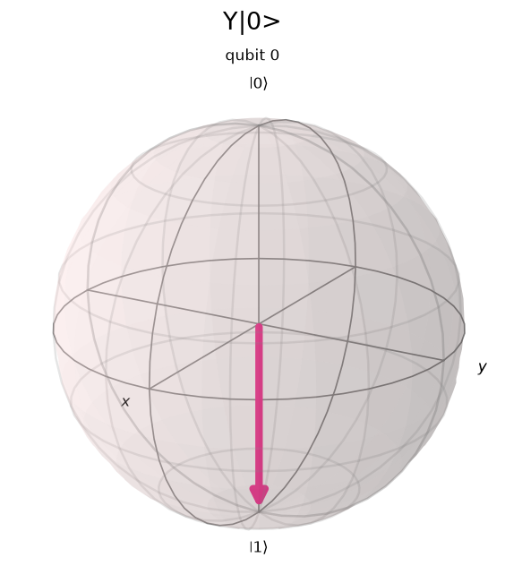 | 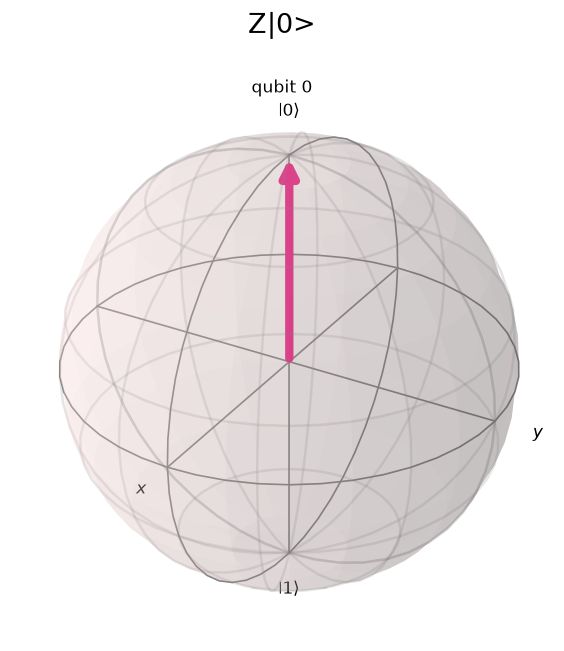 |
| on $\lvert+\rangle$ | 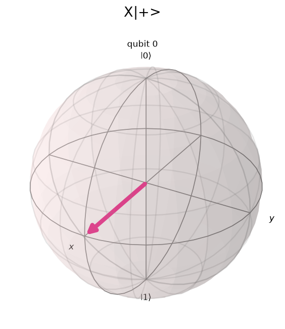 |  | 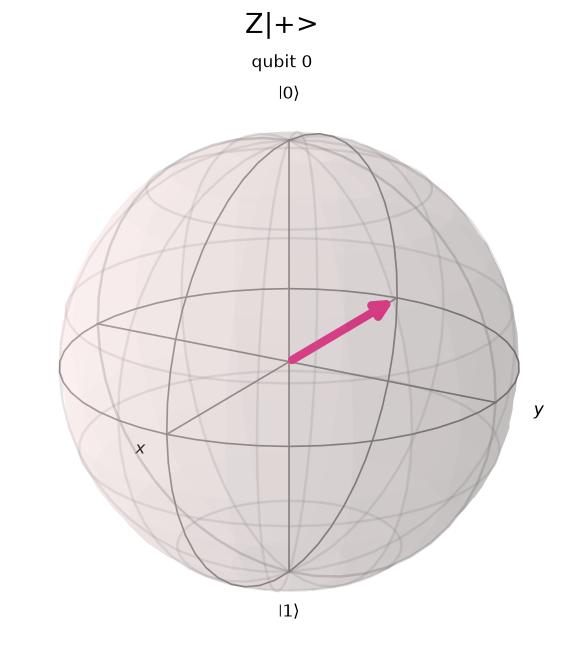 |

**Observation:** Each Pauli gate is a rotation by $\pi$ about its own axis. A state that lies on that axis does not move: $X$ leaves $\lvert+\rangle$ (on the $x$ axis) unchanged, and $Z$ leaves $\lvert0\rangle$ (on the $z$ axis) unchanged. A state off the axis is sent to the opposite point: $X$ and $Y$ send $\lvert0\rangle$ to the south pole, and $Y$ and $Z$ send $\lvert+\rangle$ to $-x$. $X\lvert0\rangle$ and $Y\lvert0\rangle$ differ only by the global phase $i$, so they have the same Bloch vector.

### Task 3 — Hadamard Gate and Measurement

```python
qc = QuantumCircuit(1, 1)
qc.h(0)
qc.measure(0, 0)
result = backend.run(qc, shots=1024, seed_simulator=42).result()
plot_histogram(result.get_counts())
```

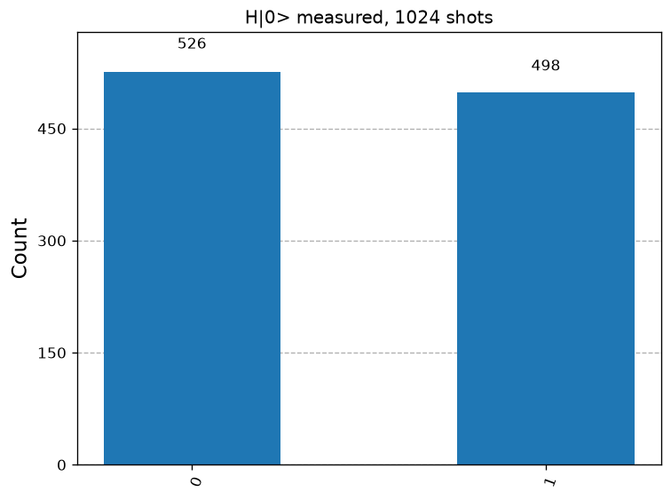

| Outcome | Expected probability | Counts (1024 shots) | Measured frequency |
|---|---|---|---|
| 0 | $\lvert1/\sqrt2\rvert^2 = 0.5$ | 526 | 0.514 |
| 1 | $\lvert1/\sqrt2\rvert^2 = 0.5$ | 498 | 0.486 |

**Observation:** The result is close to 50/50, as expected for $H\lvert0\rangle = \lvert+\rangle$. The difference from 512 is shot noise: the standard deviation of the frequency is $\sqrt{p(1-p)/N} = \sqrt{0.25/1024} \approx 0.016$, and the observed deviation of 0.014 is within one standard deviation.

### Task 4 — Phase and Rotation Gates

```python
qc = QuantumCircuit(1)
qc.s(0)   # also tried: qc.t(0), and the order h -> s, h -> t
qc.h(0)
state = Statevector.from_instruction(qc)
plot_bloch_multivector(state)
```

$S$ and $T$ change only the phase of $\lvert1\rangle$, so they do nothing to $\lvert0\rangle$. The lab-sheet order (`s` then `h`) therefore gives the same state as $H$ alone. The order was also swapped so that the phase gate acts on $\lvert+\rangle$.

**Hand calculation:**

$$HS\lvert0\rangle = H\lvert0\rangle = \lvert+\rangle, \qquad SH\lvert0\rangle = \frac{\lvert0\rangle + i\lvert1\rangle}{\sqrt2} = \lvert{+i}\rangle, \qquad TH\lvert0\rangle = \frac{\lvert0\rangle + e^{i\pi/4}\lvert1\rangle}{\sqrt2}$$

| Circuit | Operator | Statevector | Bloch vector | $\varphi$ | Bloch sphere |
|---|---|---|---|---|---|
| `s` → `h` | $HS\lvert0\rangle$ | `[0.7071, 0.7071]` | $(1, 0, 0)$ | 0 |  |
| `t` → `h` | $HT\lvert0\rangle$ | `[0.7071, 0.7071]` | $(1, 0, 0)$ | 0 |  |
| `h` → `s` | $SH\lvert0\rangle$ | `[0.7071, 0.7071j]` | $(0, 1, 0)$ | $\pi/2$ | 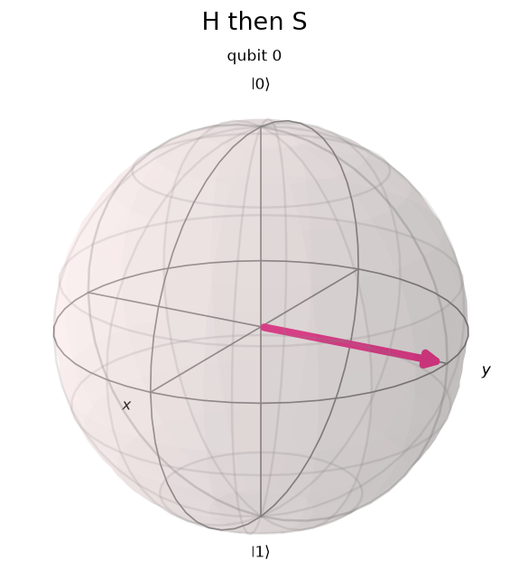 |
| `h` → `t` | $TH\lvert0\rangle$ | `[0.7071, 0.5+0.5j]` | $(0.7071, 0.7071, 0)$ | $\pi/4$ | 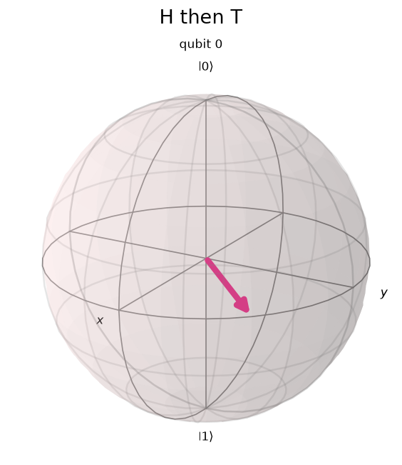 |

All four states have $P(0) = P(1) = 0.5$. After $H$, $S$ moves the state $90°$ around the equator and $T$ moves it $45°$.

**Rotation $R_y(\pi/4)$:**

```python
qc = QuantumCircuit(1)
qc.ry(pi/4, 0)
state = Statevector.from_instruction(qc)
plot_bloch_multivector(state)
```

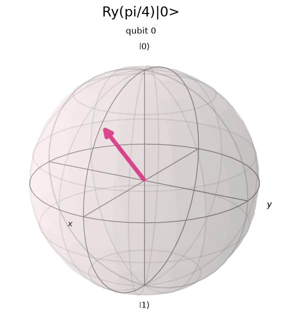

| Quantity | Hand calculation | Qiskit result |
|---|---|---|
| $\alpha = \cos\frac{\pi}{8}$ | 0.9239 | 0.9239 |
| $\beta = \sin\frac{\pi}{8}$ | 0.3827 | 0.3827 |
| $P(0), P(1)$ | 0.8536, 0.1464 | 0.8536, 0.1464 |
| Bloch vector $(\sin\frac\pi4, 0, \cos\frac\pi4)$ | $(0.7071, 0, 0.7071)$ | $(0.7071, 0, 0.7071)$ |

**Observation:** $R_y(\pi/4)$ tilts the state $45°$ from the north pole toward $+x$, matching the hand calculation exactly.

### Task 5 — Two-Qubit Gates (Bell State)

```python
bell = QuantumCircuit(2, 2)
bell.h(0)
bell.cx(0, 1)
bell.measure([0, 1], [0, 1])
result = backend.run(bell, shots=1024, seed_simulator=42).result()
plot_histogram(result.get_counts())
```

| Circuit | Histogram |
|---|---|
| 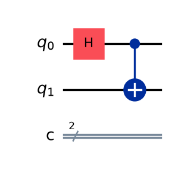 | 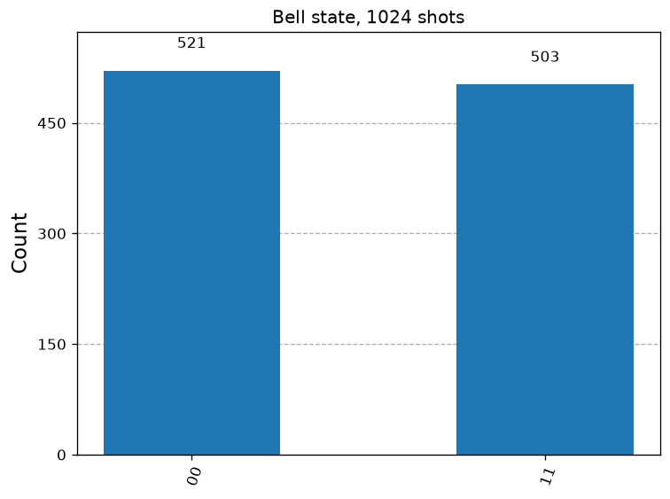 |

**Hand calculation** (Qiskit order $\lvert q_1 q_0\rangle$):

$$\lvert00\rangle \xrightarrow{H \text{ on } q_0} \frac{\lvert00\rangle + \lvert01\rangle}{\sqrt2} \xrightarrow{\mathrm{CNOT}(q_0 \to q_1)} \frac{\lvert00\rangle + \lvert11\rangle}{\sqrt2} = \lvert\Phi^+\rangle$$

| Outcome | Expected probability | Counts (1024 shots) |
|---|---|---|
| 00 | 0.5 | 521 |
| 01 | 0 | 0 |
| 10 | 0 | 0 |
| 11 | 0.5 | 503 |

The statevector before measurement was `[0.7071, 0, 0, 0.7071]`, as calculated.

**Each qubit on its own.** The reduced state of each qubit, obtained with `partial_trace`, is $\rho = I/2$ with purity $\mathrm{Tr}(\rho^2) = 0.5$ and Bloch vector $(0, 0, 0)$:

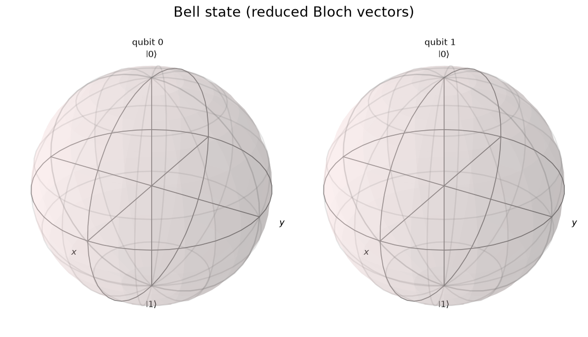

**Observation:** Only `00` and `11` appear, so the two qubits always give the same result even though each one alone is random (50/50). The Bloch spheres show no arrow because each reduced state is maximally mixed: the information is stored in the correlation between the qubits, not in either qubit. This is **entanglement**, which a product state cannot reproduce.

## 5. Exercises

### Exercise 1 — X-Y-Z Rotation

```python
for g in ["rx", "ry", "rz"]:
    qc = QuantumCircuit(1)
    getattr(qc, g)(pi/2, 0)
    state = Statevector.from_instruction(qc)
    display(plot_bloch_multivector(state))
```

| Gate applied to $\lvert0\rangle$ | Statevector | Bloch vector $(x,y,z)$ | Bloch sphere |
|---|---|---|---|
| $R_x(\pi/2)$ | `[0.7071, -0.7071j]` | $(0, -1, 0)$ | 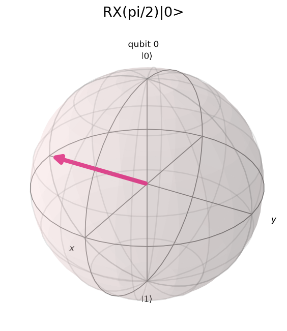 |
| $R_y(\pi/2)$ | `[0.7071, 0.7071]` | $(1, 0, 0)$ |  |
| $R_z(\pi/2)$ | `[0.7071-0.7071j, 0]` | $(0, 0, 1)$ | 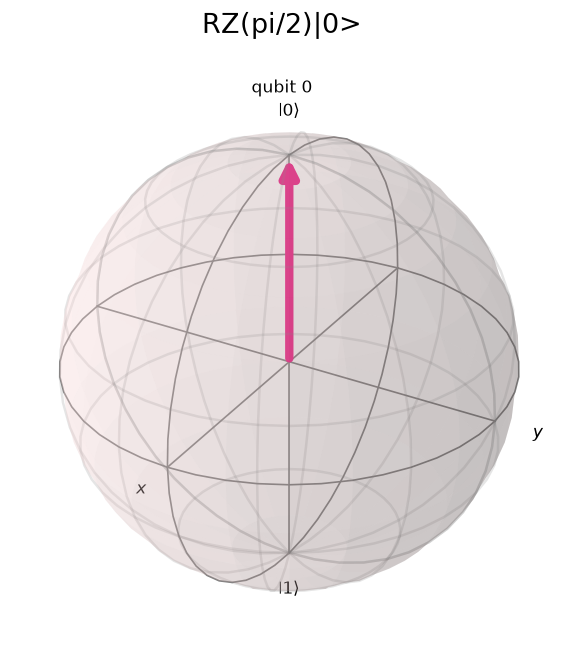 |

**Observation:** By the right-hand rule, a $90°$ rotation of $+z$ about $x$ ends at $-y$, and about $y$ ends at $+x$. $R_z(\pi/2)$ leaves $\lvert0\rangle$ at the north pole because $\lvert0\rangle$ lies on the rotation axis; the only change is the global phase $e^{-i\pi/4}$, which cannot be observed. $R_x(\pi/2)$ and $R_y(\pi/2)$ both give $P(0) = P(1) = 0.5$, while $R_z(\pi/2)$ keeps $P(0) = 1$.

### Exercise 2 — H-S Combination

```python
qc_HS = QuantumCircuit(1); qc_HS.s(0); qc_HS.h(0)   # operator H·S
qc_SH = QuantumCircuit(1); qc_SH.h(0); qc_SH.s(0)   # operator S·H
```

**Hand calculation:**

$$HS = \frac1{\sqrt2}\begin{bmatrix}1&i\\1&-i\end{bmatrix}, \quad HS\lvert0\rangle = \frac1{\sqrt2}\begin{bmatrix}1\\1\end{bmatrix} = \lvert+\rangle; \qquad SH = \frac1{\sqrt2}\begin{bmatrix}1&1\\i&-i\end{bmatrix}, \quad SH\lvert0\rangle = \frac1{\sqrt2}\begin{bmatrix}1\\i\end{bmatrix} = \lvert{+i}\rangle$$

| Operator | Statevector | Bloch vector | Bloch sphere |
|---|---|---|---|
| $HS\lvert0\rangle$ | `[0.7071, 0.7071]` | $(1, 0, 0)$ | 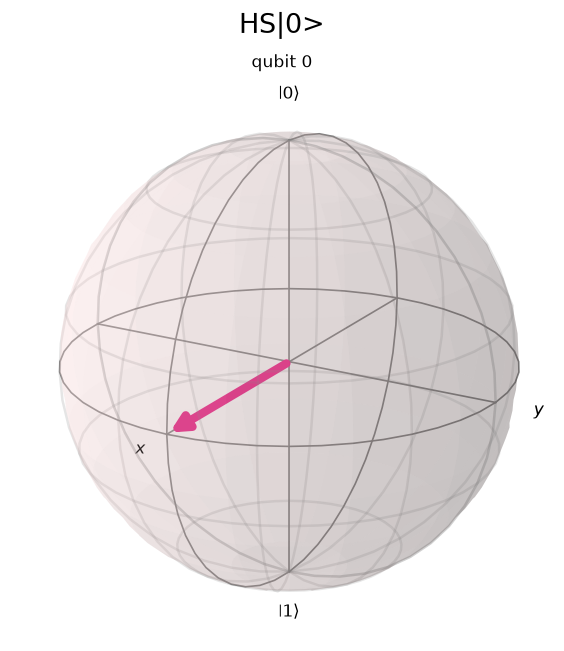 |
| $SH\lvert0\rangle$ | `[0.7071, 0.7071j]` | $(0, 1, 0)$ |  |

The notebook confirmed that the circuit `s` → `h` equals the matrix product `H @ S` (`True`) and that $HS \ne SH$ (`HS == SH ? False`).

**Observation:** Quantum gates do not commute in general. $HS\lvert0\rangle$ is $\lvert+\rangle$ because $S$ acts first, on $\lvert0\rangle$, where it does nothing. $SH\lvert0\rangle$ first creates $\lvert+\rangle$ and then $S$ rotates it $90°$ about $z$ to $\lvert{+i}\rangle$ on the $+y$ axis. Both states give $P(0)=P(1)=0.5$; they differ only in the relative phase.

### Exercise 3 — SWAP Gate

```python
qc = QuantumCircuit(2)
qc.x(0)          # |q1 q0> = |01>
qc.swap(0, 1)
qc.measure_all()
```

| Circuit | Histogram |
|---|---|
| 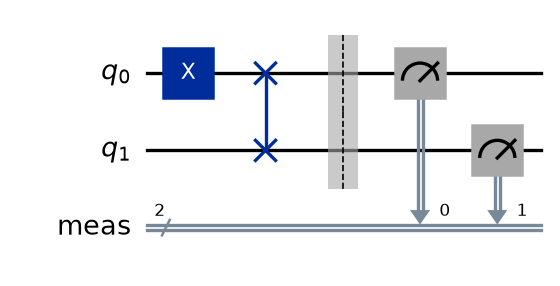 | 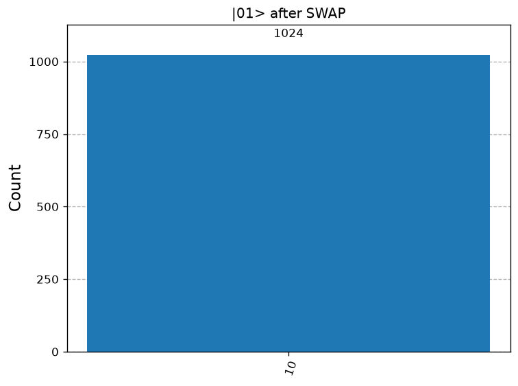 |

| | Statevector probabilities | Counts (1024 shots) |
|---|---|---|
| Before SWAP | `{'01': 1.0}` | — |
| After SWAP | `{'10': 1.0}` | `{'10': 1024}` |

**Observation:** `x(0)` sets qubit 0 to $\lvert1\rangle$, which Qiskit writes as `01` because qubit 0 is the rightmost bit. After SWAP, the $\lvert1\rangle$ is on qubit 1, giving `10` in all 1024 shots. The result is deterministic because $\lvert01\rangle$ is a basis state and SWAP maps basis states to basis states.

### Exercise 4 — CZ Gate

The control (qubit 0) was put in $\lvert+\rangle$ with $H$, and three target states (qubit 1) were tested.

```python
qc = QuantumCircuit(2)
qc.h(0)            # control in |+>
# target: nothing (|0>), qc.x(1) (|1>), or qc.h(1) (|+>)
qc.cz(0, 1)
```

**Hand calculation** ($\mathrm{CZ}$ multiplies only the $\lvert11\rangle$ amplitude by $-1$; states written as $\lvert q_1 q_0\rangle$):

$$\text{A: } \lvert0\rangle\lvert+\rangle = \frac{\lvert00\rangle + \lvert01\rangle}{\sqrt2} \xrightarrow{\mathrm{CZ}} \text{unchanged}$$

$$\text{B: } \lvert1\rangle\lvert+\rangle = \frac{\lvert10\rangle + \lvert11\rangle}{\sqrt2} \xrightarrow{\mathrm{CZ}} \frac{\lvert10\rangle - \lvert11\rangle}{\sqrt2} = \lvert1\rangle\lvert-\rangle$$

$$\text{C: } \lvert+\rangle\lvert+\rangle = \tfrac12(\lvert00\rangle + \lvert01\rangle + \lvert10\rangle + \lvert11\rangle) \xrightarrow{\mathrm{CZ}} \tfrac12(\lvert00\rangle + \lvert01\rangle + \lvert10\rangle - \lvert11\rangle)$$

| Case | Target | Statevector after CZ | Probabilities | Control qubit after CZ | Bloch spheres |
|---|---|---|---|---|---|
| A | $\lvert0\rangle$ | `[0.7071, 0.7071, 0, 0]` | 00: 0.5, 01: 0.5 (unchanged) | $\lvert+\rangle$, Bloch $(1,0,0)$, purity 1 | 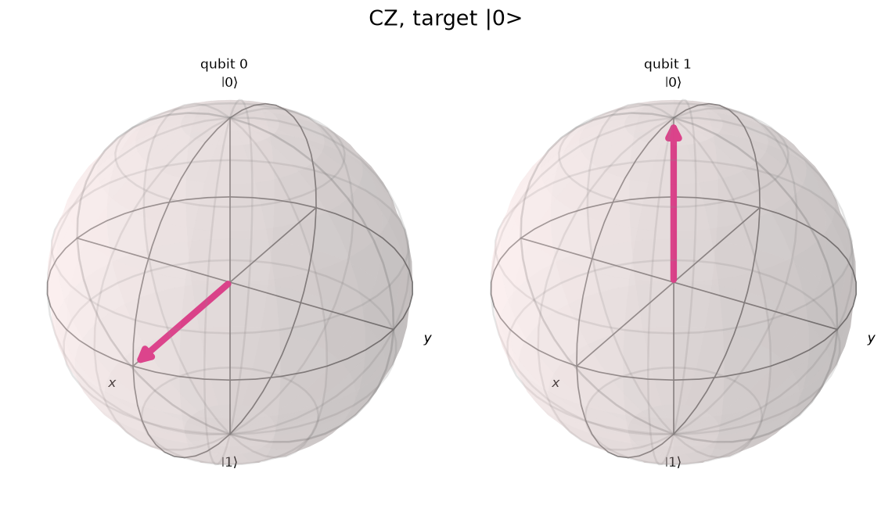 |
| B | $\lvert1\rangle$ | `[0, 0, 0.7071, -0.7071]` | 10: 0.5, 11: 0.5 (unchanged) | $\lvert-\rangle$, Bloch $(-1,0,0)$, purity 1 | 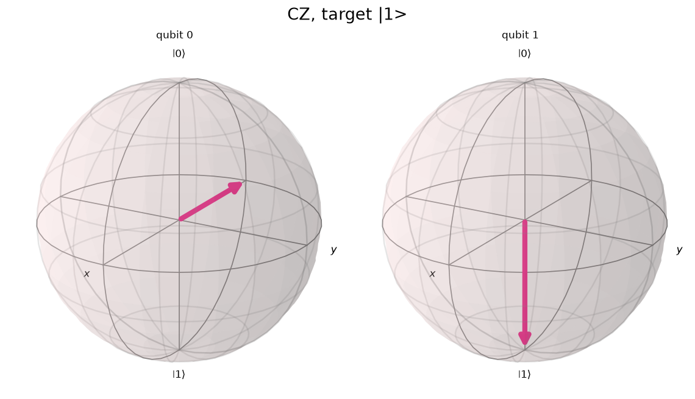 |
| C | $\lvert+\rangle$ | `[0.5, 0.5, 0.5, -0.5]` | all 0.25 (unchanged) | mixed, Bloch $(0,0,0)$, purity 0.5 | 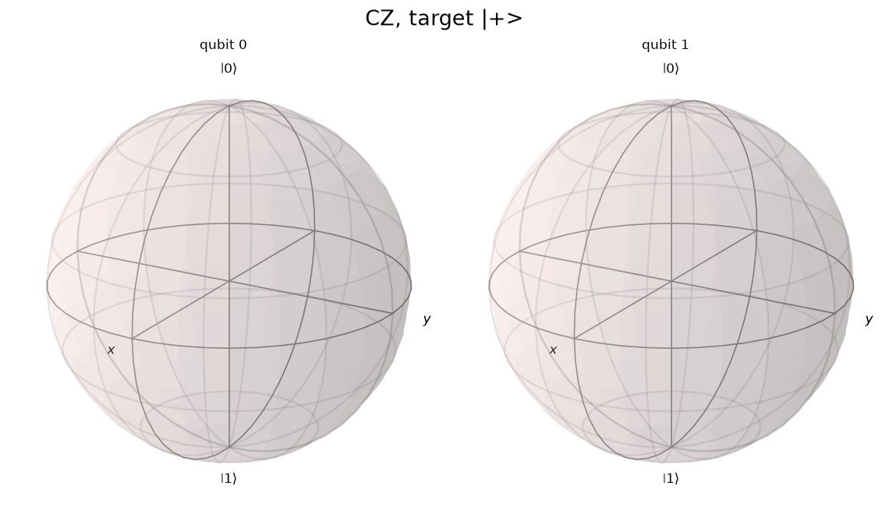 |

The notebook also confirmed that `cz(0, 1)` and `cz(1, 0)` are the same operator (`True`).

**Observation:**

- **Case A:** With the target in $\lvert0\rangle$, the $\lvert11\rangle$ amplitude is zero, so CZ does nothing.
- **Case B — phase kickback:** With the target in $\lvert1\rangle$, CZ acts as $Z$ on the **control**, turning $\lvert+\rangle$ into $\lvert-\rangle$ while the target stays $\lvert1\rangle$. Because CZ is symmetric, the "target" can change the "control".
- **Case C — entanglement:** The final state cannot be written as a product $(a\lvert0\rangle + b\lvert1\rangle)(c\lvert0\rangle + d\lvert1\rangle)$. For a product state, $\psi_{00}\psi_{11} = \psi_{01}\psi_{10}$, but here $\frac12 \cdot (-\frac12) \ne \frac12 \cdot \frac12$. The control qubit's purity drops to 0.5 and its Bloch vector shrinks to zero, as for the Bell state.

In all three cases the measurement probabilities in the computational basis did not change. CZ changes only phases, yet those phases can move a qubit on the Bloch sphere (case B) or create entanglement (case C).

### Exercise 5 — Universality Challenge

**(a) Exact constructions from {H, T, CNOT}.** Each construction was compared with Qiskit's built-in gate using `Operator.equiv` (equal up to global phase) and `np.allclose` (exactly equal).

| Target gate | Construction (operator order) | Gates used | Equivalent | Exactly equal |
|---|---|---|---|---|
| $S$ | $T \cdot T$ | 2 T | ✔ | ✔ |
| $Z$ | $T^4$ | 4 T | ✔ | ✔ |
| $X$ | $H\,T^4\,H$ | 2 H, 4 T | ✔ | ✔ |
| $Y$ | $S X S^\dagger = T^2\, H T^4 H\, T^6$ | 2 H, 12 T | ✔ | ✔ |
| CZ | $H_1\,\mathrm{CNOT}_{0\to1}\,H_1$ (H on the target) | 2 H, 1 CNOT | ✔ | ✔ |
| SWAP | $\mathrm{CNOT}_{01}\,\mathrm{CNOT}_{10}\,\mathrm{CNOT}_{01}$ | 3 CNOT | ✔ | ✔ |

($T^6 = S^\dagger$ because $T^8 = I$.)

**(b) Approximating a gate that cannot be built exactly.** $R_z(\pi/7)$ is not in the set generated exactly by H and T. Qiskit's `SolovayKitaevDecomposition` (basis H, T, T†) approximated it at increasing recursion degree:

```python
from qiskit.synthesis import SolovayKitaevDecomposition
from qiskit.circuit.library import RZGate
from qiskit.quantum_info import Operator, average_gate_fidelity

target = Operator(RZGate(pi/7))
skd = SolovayKitaevDecomposition()
for d in range(4):
    approx = skd.run(target.data, d)
    print(d, approx.size(), 1 - average_gate_fidelity(Operator(approx), target))
```

| Recursion degree | Total gates | H | T | T† | Error $1 - F_{\text{avg}}$ |
|---|---|---|---|---|---|
| 0 | 11 | 5 | 6 | 0 | $1.49\times10^{-2}$ |
| 1 | 19 | 9 | 8 | 2 | $2.49\times10^{-3}$ |
| 2 | 203 | 93 | 58 | 52 | $4.13\times10^{-4}$ |
| 3 | 1035 | 461 | 290 | 284 | $1.24\times10^{-5}$ |

**Observation:** Gates in the Clifford+T family (S, Z, X, Y, CZ, SWAP) can be built exactly. An arbitrary rotation angle can only be approximated, but the error can be made as small as needed by using longer H/T sequences: each extra recursion level reduced the error by roughly a factor of 6 to 30. This is what universality means in practice: {H, T, CNOT} is a finite gate set that can reach any unitary to any desired accuracy.

## 6. Concept Questions

**Q1. Why must quantum gates be unitary?**

> A gate must map every valid state to a valid state, so it must preserve the norm: $\langle\psi\rvert U^\dagger U\lvert\psi\rangle = 1$ for every $\lvert\psi\rangle$, which requires $U^\dagger U = I$. This keeps the measurement probabilities summing to 1. Unitarity also makes the gate reversible ($U^{-1} = U^\dagger$), which agrees with the Schrödinger equation: a closed quantum system evolves unitarily. Every gate used in Task 2 passed the check $U^\dagger U = I$.

**Q2. What is the geometric interpretation of Pauli-X, Y, Z on the Bloch sphere?**

> $X$, $Y$ and $Z$ are rotations by $\pi$ ($180°$) about the $x$, $y$ and $z$ axes. Points on the rotation axis stay fixed and all other points move to the opposite side of that axis. In Task 2, $X$ and $Y$ sent $\lvert0\rangle$ from the north pole to the south pole, $Z$ left $\lvert0\rangle$ fixed, and $Z$ sent $\lvert+\rangle$ to $\lvert-\rangle$.

**Q3. How does the Hadamard gate relate to measurement probabilities?**

> $H$ maps the poles to the equator: $H\lvert0\rangle = \lvert+\rangle$ and $H\lvert1\rangle = \lvert-\rangle$, both with $P(0) = P(1) = 0.5$, as seen in the 526 / 498 counts of Task 3. $H$ also swaps the $z$ and $x$ axes, and $H^2 = I$. So applying $H$ before a measurement is the same as measuring in the $\{\lvert+\rangle, \lvert-\rangle\}$ basis: $\lvert+\rangle$ and $\lvert-\rangle$, which give identical 50/50 results in the $z$ basis, become $\lvert0\rangle$ and $\lvert1\rangle$ and give definite results. $H$ thus turns phase information into measurable probabilities.

**Q4. What makes {H, T, CNOT} a universal gate set?**

> $H$ and $T$ are rotations about different axes, and $T$ is not a Clifford gate. Combined, they generate a dense subset of all single-qubit rotations, so any single-qubit gate can be approximated as closely as desired. CNOT adds entanglement, and CNOT plus arbitrary single-qubit gates can build any multi-qubit unitary. The Solovay–Kitaev theorem shows the approximation needs only $O(\log^{c}(1/\varepsilon))$ gates. Exercise 5 showed both parts: exact constructions of S, Z, X, Y, CZ and SWAP, and an approximation of $R_z(\pi/7)$ with error down to $10^{-5}$. Without $T$, the set {H, S, CNOT} is finite and can be simulated classically, so it is not universal.

**Q5. Why can't measurement be represented as a unitary operation?**

> Measurement is irreversible and many-to-one. Measuring $\lvert0\rangle$, $\lvert+\rangle$ or $\lvert{+i}\rangle$ can all leave the qubit in $\lvert0\rangle$, so the original state cannot be recovered, whereas a unitary always has an inverse. Measurement is described by projectors such as $P_0 = \lvert0\rangle\langle0\rvert$, which satisfy $P_0^2 = P_0$ and are not invertible. It also destroys phase information (for example, $\lvert+\rangle$ and $\lvert-\rangle$ give identical statistics) and has a random outcome, while a unitary is deterministic. This is why Qiskit treats `measure` as a separate, non-unitary instruction.

## 7. Discussion

**Theory vs. simulation.** Every statevector, probability and Bloch vector computed by Qiskit matched the hand calculations exactly, including the phases ($Y\lvert0\rangle = i\lvert1\rangle$, $TH\lvert0\rangle$ with $\varphi = \pi/4$) and the CZ results. The only differences came from finite sampling: 526 / 498 for $H\lvert0\rangle$ and 521 / 503 for the Bell state instead of exactly 512 / 512. Both are within one standard deviation ($\approx 16$ counts) of the expected values, and the forbidden outcomes `01` and `10` never appeared in the Bell experiment.

**Problems faced.** `qiskit-aer` was not installed in the system Python used in Lab 1, so a new virtual environment with Python 3.14 was created. Two conventions caused confusion and had to be checked carefully. First, circuit order and matrix order are reversed: the lab sheet's `s` → `h` circuit is $HS$, which gave $\lvert+\rangle$ and seemed to show that $S$ had no effect until the order was swapped. Second, Qiskit writes qubit 0 as the rightmost bit, so `x(0)` produces `01`, not `10`. The Bloch spheres for the Bell state and for CZ case C showed no arrows; this is not a bug but the signature of entanglement.

**Key insight.** Many gates in this lab changed only phases: Z, S, T and CZ never changed the computational-basis probabilities. Their effect became visible only when combined with $H$ (which turns phase into probability) or when they acted on superpositions. CZ in particular showed that a gate which only flips the sign of one amplitude can move the "control" qubit through phase kickback or entangle two qubits. Phase is therefore a real physical resource, and a small universal set such as {H, T, CNOT} is enough to control it to any accuracy.

## 8. Conclusion

In this lab, all basic gates were confirmed to be unitary, and their effects on single and two-qubit states were measured in Qiskit. The Pauli gates act as $\pi$ rotations, $H$ creates equal superpositions, $S$ and $T$ rotate the phase by $90°$ and $45°$, CNOT creates a Bell state, SWAP exchanges qubits, and CZ changes only phases yet can produce phase kickback and entanglement. All simulated results agreed with hand calculations. Exercise 5 showed that {H, T, CNOT} builds Clifford gates exactly and approximates other gates to any accuracy. All the objectives of the lab were met.

## 9. References

1. IBM Quantum Learning (formerly the Qiskit Textbook). https://quantum.cloud.ibm.com/learning
2. M. A. Nielsen and I. L. Chuang, *Quantum Computation and Quantum Information*, Cambridge University Press, Chapter 4.
3. J. Preskill, *Lecture Notes for Physics 229: Quantum Computation*, Caltech.
4. IBM Quantum Documentation. https://quantum.cloud.ibm.com/docs
5. C. M. Dawson and M. A. Nielsen, "The Solovay–Kitaev algorithm," *Quantum Information and Computation* 6(1), 2006.
6. Lab sheet: komsan-k, *Lab 2: Simple Quantum Gates*. https://github.com/komsan-k/quantum-computation/tree/main/lab/lab-2-quantum-gates

## Appendix — Full Code

The complete, runnable code is in the notebook [lab-2-quantum-gates.ipynb](lab-2-quantum-gates.ipynb) (Colab link in the header table). Each figure in this report is saved by the notebook to `images/` under the same file name.

---

*Verified locally on 2026-10-19: Python 3.14.6, Qiskit 2.6.0, Qiskit Aer 0.17.2. The notebook was executed from top to bottom without errors, and every number in this report was copied from its output.*
