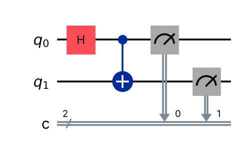
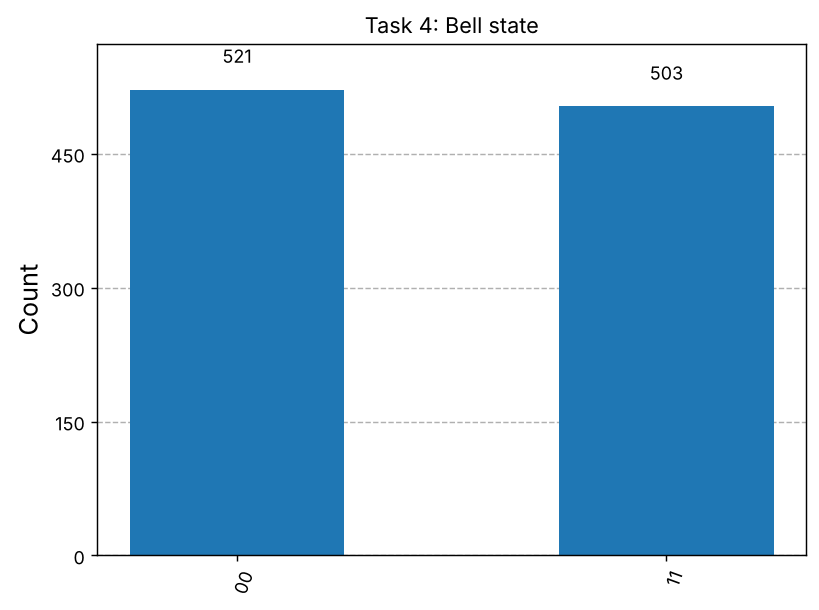
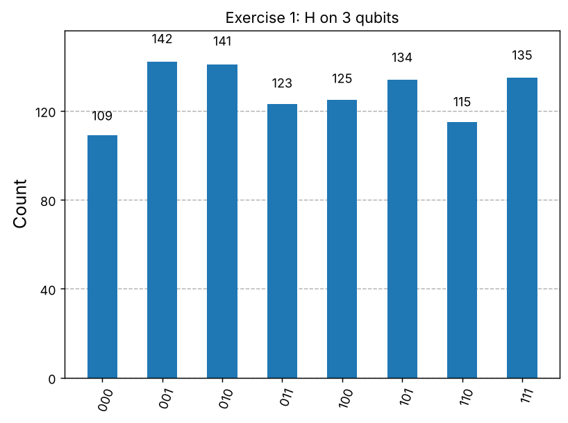
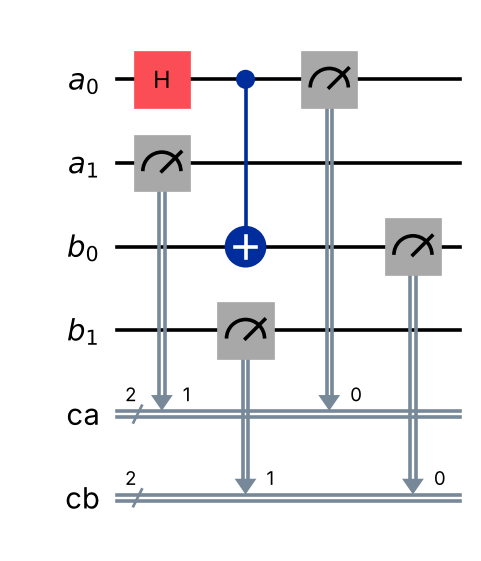
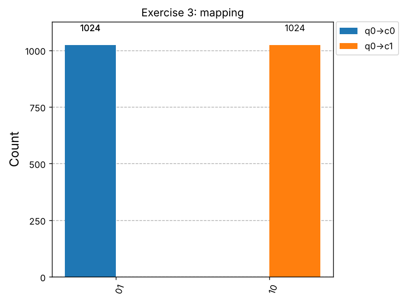
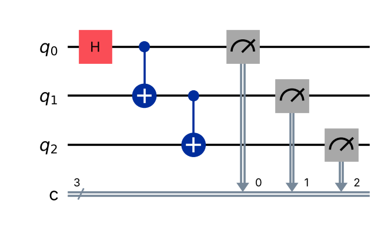
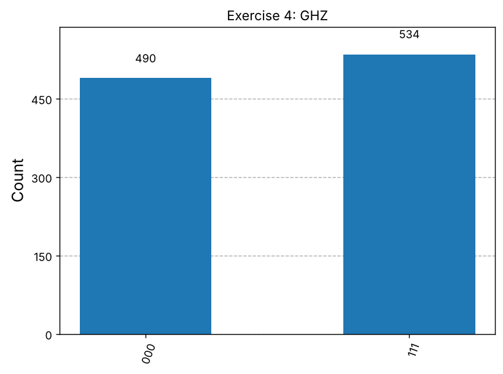
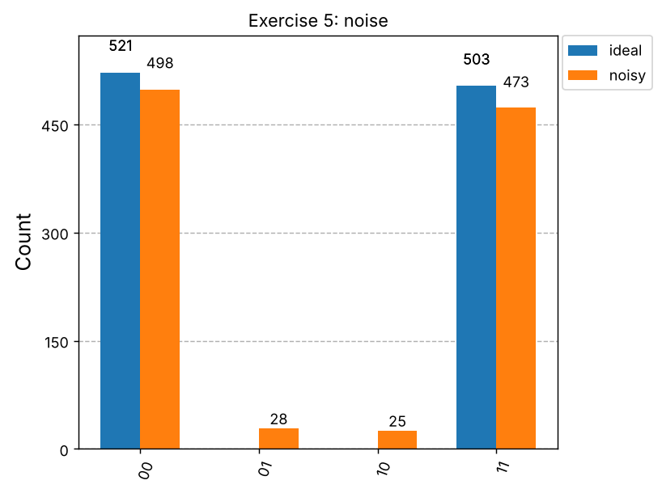

# Lab 3 Report: Basic Quantum Registers

**Student:** ยามาอัลลุดดีน เจ๊ะหามะ (Ang), AISE Cohort 3, College of Computing, PSU Phuket
**Course:** Quantum Computation, Lab 3
**Date:** 3 November 2026
**Tools:** Qiskit 2.6.1, Qiskit Aer 0.18.2 (`aer_simulator`), 1024 shots, simulator seed 42
**Code:** [`lab-3-quantum-register.ipynb`](lab-3-quantum-register.ipynb)  
**Colab:** 

---

## 1. Objectives

This lab shows that registers only group and name bits. The way registers are declared does not change the physics of a circuit. The mapping from qubits to classical bits does change how the results are read.

- Understand quantum registers as containers for qubits.
- Distinguish quantum registers (qubits) from classical registers (measurement outcomes).
- Build circuits with explicit register allocation in Qiskit.
- Map quantum measurements to classical registers.
- Compare the register-first and circuit-first styles in Qiskit.

---

## 2. Background

An n-qubit quantum register holds one quantum state in a 2ⁿ-dimensional space. Measuring it gives an n-bit classical result, and that result has to be stored in a classical register.

**Quantum register.** A group of n qubits treated as one system, written |qₙ₋₁ … q₁ q₀⟩. Its general state is

$$
|\psi\rangle = \sum_{x=0}^{2^n-1} \alpha_x |x\rangle, \qquad \sum_{x=0}^{2^n-1} |\alpha_x|^2 = 1
$$

For n = 2, the basis states are |00⟩, |01⟩, |10⟩ and |11⟩.

**Classical register.** Stores measurement outcomes as ordinary bits. Measuring the register gives outcome x with probability |αₓ|².

**Register vs circuit.** The register is where the qubits live. The circuit is the set of operations applied to them. Qiskit supports two styles:

| Style | How it is written | Qubits addressed as |
| --- | --- | --- |
| Register-first (explicit) | `QuantumRegister`, `ClassicalRegister`, then `QuantumCircuit(qreg, creg)` | `qreg[0]` |
| Circuit-first (implicit) | `QuantumCircuit(n, m)` | `0, 1, …` |

**Bit order.** Qiskit is little-endian. In a result string such as `01`, the rightmost character is classical bit 0.

---

## 3. Lab Tasks

The 2-qubit Bell circuit was built three ways: with explicit registers, with implicit registers, and split across two registers. All three gave the same result: only `00` and `11`, each about 50% of shots.

1. **Setup (Task 1).** Installed `qiskit`, `qiskit-aer` and `pylatexenc` in Colab. `pylatexenc` is needed for `draw('mpl')`.
2. **Explicit registers (Task 2).** Created `QuantumRegister(2,'q')` and `ClassicalRegister(2,'c')`. Applied H on q[0] and CNOT q[0]→q[1], then measured q into c.
3. **Implicit registers (Task 3).** Built the same circuit with `QuantumCircuit(2, 2)`. Qiskit created the registers `QuantumRegister(2,'q')` and `ClassicalRegister(2,'c')` automatically.
4. **Running the circuit (Task 4).** Ran the Task 2 circuit on `aer_simulator`.
5. **Multi-register (Task 5).** Put one qubit in register `a` and one in register `b`, then entangled a[0] with b[0].

| Circuit | 00 | 11 | 01 / 10 |
| --- | --- | --- | --- |
| Task 4: Bell state, explicit registers | 521 | 503 | 0 |
| Task 5: Bell state across registers a, b | 521 | 503 | 0 |

The two qubits were never measured as different values. This is the signature of the entangled state (|00⟩ + |11⟩)/√2. Splitting the qubits into registers `a` and `b` changed only their names, not the physics.

---

## 4. Exercises

All five exercises matched what theory predicts. The result that needs the most care is Exercise 3: crossing the wiring flipped the output from `01` to `10` while the quantum state stayed the same.

### Exercise 1: H on every qubit of a 3-qubit register

| Outcome | 000 | 001 | 010 | 011 | 100 | 101 | 110 | 111 |
| --- | --- | --- | --- | --- | --- | --- | --- | --- |
| Shots | 109 | 142 | 141 | 123 | 125 | 134 | 115 | 135 |

The state is (H|0⟩)⊗3 = (1/√8) Σ|x⟩. This is a uniform superposition, with |αₓ|² = 1/8 for all 8 outcomes, so each outcome is expected about 1024/8 = 128 times. The observed spread of 109 to 142 is shot noise from a finite sample of 1024 shots.

### Exercise 2: Entangling qubits from two separate 2-qubit registers

Registers `a` and `b` (2 qubits each) were measured into `ca` and `cb`. The circuit applies H on a[0], then CNOT a[0]→b[0].

| Result (`cb ca`) | Meaning | Shots |
| --- | --- | --- |
| `00 00` | a[0] = 0, b[0] = 0 | 506 |
| `01 01` | a[0] = 1, b[0] = 1 | 518 |

Qiskit prints the last-added register first, and within each register bit 0 is on the right. a[0] and b[0] always agree, so entanglement works across register boundaries. a[1] and b[1] stay 0 because no gate acted on them.

### Exercise 3: Measuring `qreg[0]` into `creg[1]`

A Bell state cannot show this effect, because `00` and `11` look the same when the bits are swapped. With crossed wiring it still gave 521 / 503. An asymmetric state was used instead: X on q[0], so q0 = 1 and q1 = 0.

| Wiring | Result | Shots |
| --- | --- | --- |
| q0→c0, q1→c1 (normal) | `01` | 1024 |
| q0→c1, q1→c0 (crossed) | `10` | 1024 |

The quantum state is identical in both runs. Only the slot the answer is written into moved. Because the string is printed as `c1 c0`, a wrong mapping silently reorders the result.

### Exercise 4: 3-qubit GHZ, explicit registers vs `QuantumCircuit(3,3)`

Both versions apply H on qubit 0, then CNOT 0→1 and CNOT 1→2.

| | (a) Explicit registers | (b) `QuantumCircuit(3,3)` |
| --- | --- | --- |
| Counts | `000`: 490, `111`: 534 | `000`: 490, `111`: 534 |
| Same unitary (`Operator.equiv`) | True | True |
| Qubits addressed as | `qr[0]`, `qr[1]`, `qr[2]` | `0`, `1`, `2` |
| Register names | chosen by us (`q`, `c`) | created by Qiskit (`q`, `c`) |
| Suits | algorithms with several parts | small, quick circuits |

The two styles build the same circuit. They differ only in readability and organisation.

### Exercise 5 (optional): Depolarizing noise on the Bell circuit

The noise model uses a depolarizing error of p = 0.05 on 1-qubit gates (`h`, `x`) and p = 0.10 on `cx`. These rates are exaggerated so the effect is visible.

| Outcome | Ideal | Noisy |
| --- | --- | --- |
| `00` | 521 | 498 |
| `11` | 503 | 473 |
| `01` | 0 | 28 |
| `10` | 0 | 25 |
| P(00 or 11) | 1.000 | 0.948 |

Noise makes the forbidden outcomes `01` and `10` appear. The CNOT carries the larger error, which matches real hardware, where two-qubit gates are the noisiest operations.

---

## 5. Concept Questions

**Q1. Why do we need classical registers in addition to quantum registers?**
A quantum state cannot be read directly. Measurement collapses it to one classical outcome, and that outcome must be stored somewhere, which is the classical register. Classical bits also make feedback possible, such as gates that depend on a mid-circuit measurement in teleportation or error correction.

**Q2. What is the difference between creating registers explicitly and implicitly in Qiskit?**
Explicitly, we create named `QuantumRegister` and `ClassicalRegister` objects and address qubits as `qreg[i]`. This suits algorithms with several logical parts. Implicitly, `QuantumCircuit(n, m)` creates default registers `q` and `c`, and qubits are addressed by integer index. Exercise 4 showed that both styles build the same unitary and give the same counts.

**Q3. Can a circuit exist without registers? Why or why not?**
An empty `QuantumCircuit()` can be created, but it cannot do anything, because gates need qubits to act on. Qiskit also allows loose `Qubit()` and `Clbit()` objects that are not in any named register. So a named register is not strictly required, but bits are. A circuit with no classical bits can still be simulated as a statevector; it just cannot record measurements.

**Q4. How does the number of classical bits affect the ability to record measurement results?**
Each measured qubit needs one classical bit. With m classical bits, we can store at most m qubit outcomes (2ᵐ possible patterns). With fewer bits than measured qubits, results are lost or overwritten. Extra bits are allowed and stay 0.

**Q5. In an algorithm like Grover's, why is it important to manage registers carefully?**
Grover's algorithm uses qubits with different roles: a search register that holds the superposition of candidates, often an ancilla prepared in |−⟩ for phase kickback, and classical bits for the answer. Separate, named registers make sure that:

- the H gates and the diffuser act only on the search register;
- the oracle connects the right qubits;
- only the search register is measured, into the right bits in the right order.

Exercise 3 showed that a wrong mapping gives a wrong answer with no error message.

---

## 6. Conclusion

Registers are an organising layer. Explicit, implicit and multi-register circuits produced identical states and identical counts. The qubit-to-classical-bit mapping is what changes the results, because it silently reorders the output string. Noise shows a second practical limit: a 10% depolarizing error on CNOT sent 5.2% of shots to outcomes the ideal Bell state never produces.

---

## References

- Lab 3 handout: [komsan-k/quantum-computation](https://github.com/komsan-k/quantum-computation/tree/c441d00642cbf55a4e74388327c8d80d0622101f/lab/lab-3-quantum-register)
- [IBM Quantum Documentation](https://docs.quantum.ibm.com)
- Qiskit Textbook: [Learn Quantum Computation using Qiskit](https://qiskit.org/textbook/)
- Nielsen, M. A. & Chuang, I. L., *Quantum Computation and Quantum Information*, Cambridge University Press.
- Preskill, J., *Quantum Computing Lecture Notes*, Caltech.
