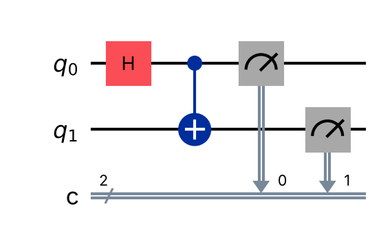
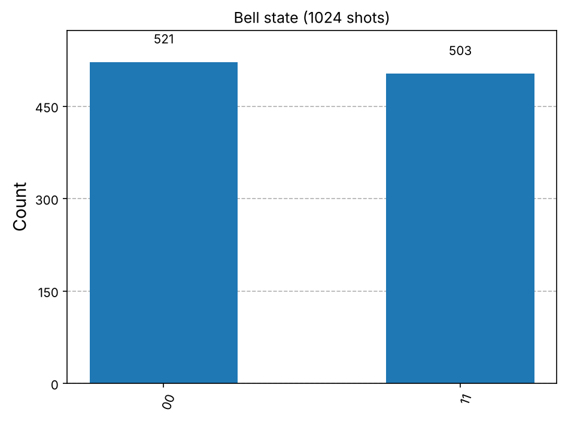
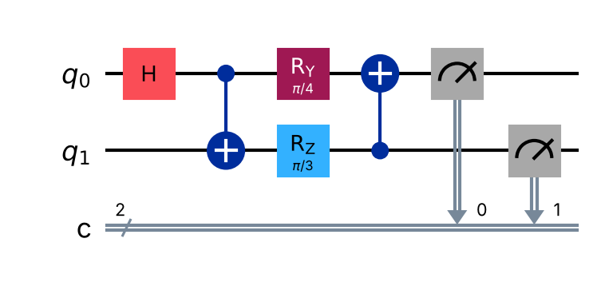
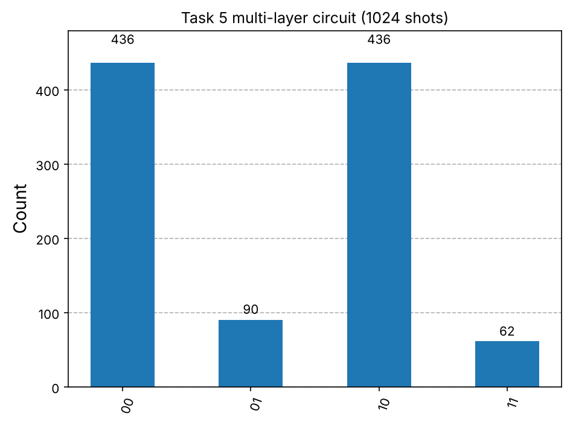
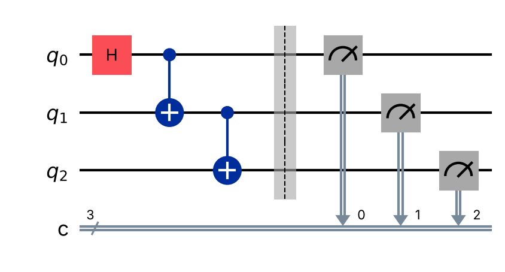
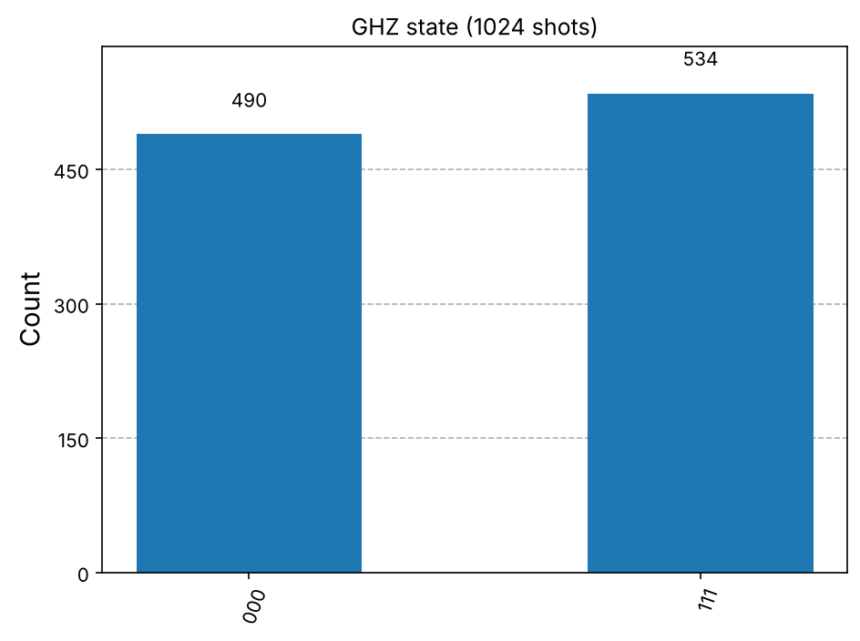
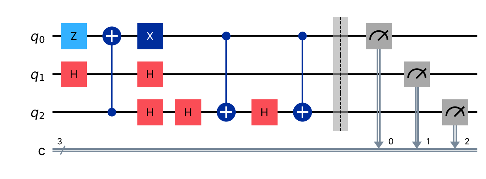
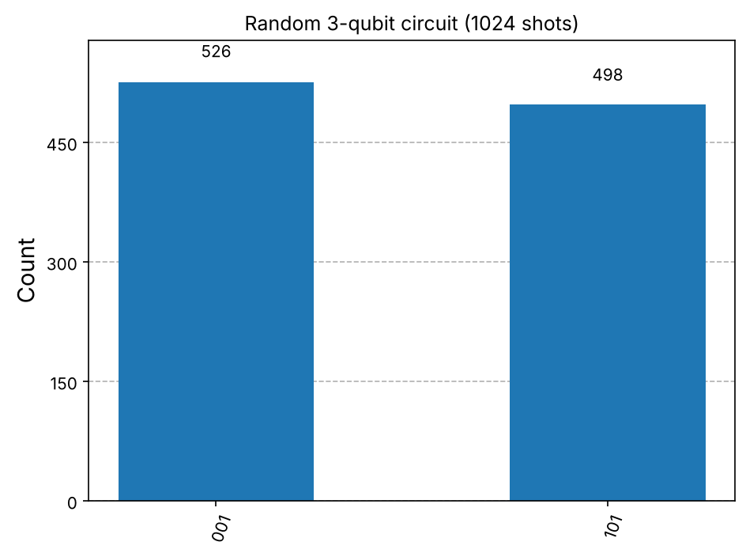

# Lab 4: Basic Quantum Circuits — Report

**Student:** ยามาอัลลุดดีน เจ๊ะหามะ  
**Program:** AISE, College of Computing, Prince of Songkla University (Phuket Campus)  
**Tools:** Python, Qiskit 2.6.1, Qiskit Aer 0.18.2, Google Colab  
**Notebook:** [`lab-4-quantum-circuit.ipynb`](lab-4-quantum-circuit.ipynb)

---

## 1. Objectives

- เข้าใจโครงสร้างและบทบาทของ **quantum circuit**
- ประกอบวงจรหลายเกต หลายคิวบิตด้วย **Qiskit**
- ใช้ **measurement** เพื่อดึงผลลัพธ์แบบคลาสสิก
- จำลองวงจรด้วย **Qiskit Aer** และตีความผล
- แสดงภาพวงจร, statevector และ histogram ของการวัด

## 2. Background (สรุปสั้น)

Quantum circuit คือลำดับของ quantum gate ที่กระทำกับคิวบิต แล้ว (มัก) ตามด้วยการวัด

$$|\psi_{out}\rangle = U\,|\psi_{in}\rangle, \qquad U = U_n \cdots U_2 U_1$$

ถ้า $|\psi\rangle = \alpha|0\rangle + \beta|1\rangle$ ความน่าจะเป็นที่วัดได้ 0 คือ $|\alpha|^2$ และได้ 1 คือ $|\beta|^2$

> **หมายเหตุเรื่องลำดับบิต:** Qiskit ใช้ little-endian คือสตริงผลลัพธ์อ่านเป็น `q2 q1 q0` (บิตขวาสุดคือ q0)

## 3. Method

ทุกการจำลองใช้ `aer_simulator` จำนวน **1024 shots** และกำหนด `seed_simulator=42` เพื่อให้ผลซ้ำได้ ผลทางทฤษฎีคำนวณจาก `Statevector` ของวงจรเดียวกันที่ตัด measurement ออก แล้วนำมาเทียบกับผลจาก shots

---

## 4. Results — Lab Tasks

### Task 1 — Setup
ติดตั้ง `qiskit`, `qiskit-aer`, `pylatexenc` (สำหรับวาดวงจร) และ `sympy` (สำหรับแสดง statevector แบบ LaTeX) บน Colab

### Task 2 — Bell State Circuit



วงจร: H บน q0 → CNOT (q0 → q1) → วัดทั้งสองคิวบิต

- H ทำให้ q0 เป็น $\frac{1}{\sqrt2}(|0\rangle+|1\rangle)$
- CNOT คัดลอก "ค่าของ q0" ไปที่ q1 ในทุก branch ของ superposition จึงได้

$$|\Phi^+\rangle = \frac{1}{\sqrt2}(|00\rangle + |11\rangle)$$

### Task 3 — Simulation with Qiskit Aer



| Outcome | Counts | Measured P | Theory P |
|---|---|---|---|
| 00 | 521 | 0.509 | 0.500 |
| 11 | 503 | 0.491 | 0.500 |
| 01, 10 | 0 | 0 | 0 |

ตรงกับ expected outcome: มีแค่ `00` และ `11` ประมาณ 50/50 ส่วนต่างเล็กน้อยจาก 0.5 มาจาก **shot noise** (ความคลาดเคลื่อนเชิงสถิติ ~ $1/\sqrt{N} \approx 0.03$ ที่ N = 1024) ไม่มี `01` หรือ `10` เลย แสดงว่าคิวบิตทั้งสอง **entangled** กัน: วัดตัวหนึ่งได้อะไร อีกตัวได้ค่าเดียวกันเสมอ

### Task 4 — Statevector Simulation

```
Statevector([0.70710678+0.j, 0, 0, 0.70710678+0.j], dims=(2, 2))
```

amplitude ของ $|00\rangle$ และ $|11\rangle$ เท่ากับ $1/\sqrt2 \approx 0.7071$ ความน่าจะเป็นจึงเป็น 0.5 ทั้งคู่ ตรงกับ Task 3

ข้อสังเกต: statevector ให้ข้อมูล **ทั้งหมด** ของสถานะ (รวม phase) ในขณะที่การวัดด้วย shots ให้แค่ความน่าจะเป็นโดยประมาณ ซึ่งบนฮาร์ดแวร์จริงจะเห็นได้แค่แบบหลังเท่านั้น

### Task 5 — Adding More Layers





| Outcome | Counts | Measured P | Theory P |
|---|---|---|---|
| 00 | 436 | 0.426 | 0.4268 |
| 01 | 90 | 0.088 | 0.0732 |
| 10 | 436 | 0.426 | 0.4268 |
| 11 | 62 | 0.061 | 0.0732 |

Circuit depth = **5**

**วิเคราะห์ (ไล่ทีละขั้น ใช้ลำดับ `q1 q0`, ให้ $c=\cos(\pi/8)$, $s=\sin(\pi/8)$):**

1. H + CX → $\frac{1}{\sqrt2}(|00\rangle + |11\rangle)$
2. $R_y(\pi/4)$ บน q0 หมุน q0 บน Bloch sphere: $|0\rangle \to c|0\rangle + s|1\rangle$, $|1\rangle \to -s|0\rangle + c|1\rangle$  
   → $\frac{1}{\sqrt2}(c|00\rangle + s|01\rangle - s|10\rangle + c|11\rangle)$
3. $R_z(\pi/3)$ บน q1 เปลี่ยนแค่ **phase** จึงไม่กระทบความน่าจะเป็นที่วัดใน Z-basis
4. CX (q1 → q0) สลับ $|10\rangle \leftrightarrow |11\rangle$ → ขนาด amplitude เป็น $c, s, c, s$ สำหรับ `00, 01, 10, 11`

ดังนั้น $P(00)=P(10)=c^2/2 = 0.4268$ และ $P(01)=P(11)=s^2/2 = 0.0732$ ตรงกับผลจำลอง  
สรุป: การเพิ่ม rotation ทำลายความสัมพันธ์สมบูรณ์แบบของ Bell state ทำให้มีผลลัพธ์ครบทั้ง 4 แบบ

---

## 5. Exercises

### Exercise 1 — Three-Qubit GHZ Circuit

เป้าหมาย: $|000\rangle \to \frac{1}{\sqrt2}(|000\rangle + |111\rangle)$

```python
ghz = QuantumCircuit(3, 3)
ghz.h(0)
ghz.cx(0, 1)
ghz.cx(1, 2)
ghz.measure([0, 1, 2], [0, 1, 2])
```





**Statevector:** amplitude $1/\sqrt2$ ที่ $|000\rangle$ และ $|111\rangle$ เท่านั้น ส่วนอื่นเป็น 0

| Outcome | Counts | Measured P | Theory P |
|---|---|---|---|
| 000 | 490 | 0.479 | 0.5 |
| 111 | 534 | 0.521 | 0.5 |

**อธิบาย:** GHZ เป็นการขยาย Bell state ไป 3 คิวบิต H สร้าง superposition ที่ q0 แล้ว CNOT สองตัวส่งต่อค่าไปยัง q1 และ q2 ทีละคิวบิต ผลการวัดจึงมีแค่ "ทุกตัวเป็น 0" หรือ "ทุกตัวเป็น 1" ไม่มีกรณีที่คิวบิตใดต่างจากตัวอื่น

> ทางเลือก: ใช้ `cx(0,1)` และ `cx(0,2)` (fan-out จาก q0) ก็ได้สถานะเดียวกัน ตรวจด้วย `Statevector.equiv()` แล้วได้ `True`

### Exercise 2 — Random 3-Qubit Circuit

สุ่มเกต 10 ตัวจาก {H, X, Z, CX} ด้วย `random.seed(7)` ได้ลำดับ:

```
Z(q0), CX(2->0), H(q2), H(q1), H(q2), X(q0), H(q1), CX(0->2), H(q2), CX(0->2)
```





| Outcome (`q2 q1 q0`) | Counts | Measured P | Theory P |
|---|---|---|---|
| 001 | 526 | 0.514 | 0.5 |
| 101 | 498 | 0.486 | 0.5 |

Circuit depth = **7**

**อธิบายผล — ไล่ statevector ทีละเกต:**

| Gate | State after gate |
|---|---|
| Z(q0) | \|000⟩ — Z บน \|0⟩ ไม่เปลี่ยนอะไร |
| CX(2→0) | \|000⟩ — control q2 = 0 จึงไม่ทำงาน |
| H(q2) | 0.707\|000⟩ + 0.707\|100⟩ |
| H(q1) | superposition 4 term |
| H(q2) | 0.707\|000⟩ + 0.707\|010⟩ — **H·H = I** q2 กลับเป็น \|0⟩ |
| X(q0) | 0.707\|001⟩ + 0.707\|011⟩ — q0 พลิกเป็น 1 |
| H(q1) | \|001⟩ — H·H = I อีกครั้ง q1 กลับเป็น \|0⟩ |
| CX(0→2) | \|101⟩ — q0 = 1 จึงพลิก q2 |
| H(q2) | 0.707\|001⟩ - 0.707\|101⟩ — q2 เป็น \|-⟩ |
| CX(0→2) | -0.707\|001⟩ + 0.707\|101⟩ — X บน \|-⟩ ให้แค่ global phase −1 |

**สรุป:** แม้จะมี 10 เกต แต่หลายเกต "หักล้างกันเอง" (H สองครั้งติดกันบนคิวบิตเดียว = identity, Z และ CX ที่กระทำกับ $|0\rangle$ ไม่มีผล) สถานะสุดท้ายจึงเป็น **product state** $|-\rangle_{q2}\otimes|0\rangle_{q1}\otimes|1\rangle_{q0}$ ซึ่ง **ไม่มี entanglement**

- q0 = 1 เสมอ (จาก X)
- q1 = 0 เสมอ
- q2 อยู่ใน $|-\rangle$ จึงวัดได้ 0 หรือ 1 อย่างละ 50%

ผลจึงมีแค่ `001` และ `101` ประมาณ 50/50 ตรงกับ histogram  
บทเรียนคือ ขนาดของวงจร (จำนวนเกต) ไม่ได้บอกว่าสถานะซับซ้อนแค่ไหน ต้องดูว่าเกตทำงานร่วมกันอย่างไร

---

## 6. Concept Questions

**1. Quantum gate กับ quantum circuit ต่างกันอย่างไร?**  
Gate คือ unitary operation ตัวเดียว (เช่น H, X, CNOT) ที่กระทำกับคิวบิตจำนวนน้อย ส่วน circuit คือการนำ gate หลายตัวมาเรียงตามลำดับเวลาบนหลายคิวบิต รวมถึงการ initialize และ measurement ทั้งหมดเทียบเท่ากับ unitary รวม $U = U_n \cdots U_1$ ตามด้วยการวัด เปรียบได้ว่า gate คือคำสั่งเดี่ยว ส่วน circuit คือทั้งโปรแกรม

**2. ทำไมลำดับของเกตถึงสำคัญ?**  
เพราะเมทริกซ์ส่วนใหญ่ **ไม่สลับที่กัน** ($AB \neq BA$) จากการทดลองเพิ่มเติมใน notebook:
- H แล้ว X บน $|0\rangle$ → $\frac{1}{\sqrt2}(|0\rangle + |1\rangle) = |+\rangle$
- X แล้ว H บน $|0\rangle$ → $\frac{1}{\sqrt2}(|0\rangle - |1\rangle) = |-\rangle$

สองสถานะนี้ให้ความน่าจะเป็นเท่ากันใน Z-basis แต่ phase ต่างกัน ซึ่งเมื่อผ่านเกตต่อไป (เช่น H อีกตัว) จะให้ผลลัพธ์ต่างกันสิ้นเชิง ($|0\rangle$ กับ $|1\rangle$)

**3. Measurement ต่างจาก unitary gate อย่างไร?**

| Unitary gate | Measurement |
|---|---|
| ย้อนกลับได้ (U†U = I) | ย้อนกลับไม่ได้ |
| Deterministic — สถานะเดิมได้ผลเดิม | Probabilistic — ผลเป็นไปตาม \|α\|², \|β\|² |
| รักษา superposition และ phase | ทำให้สถานะ collapse เป็น basis state |
| ผลลัพธ์เป็นสถานะควอนตัม | ผลลัพธ์เป็นบิตคลาสสิก |

**4. ทำไม CNOT จำเป็นต่อการสร้าง entanglement?**  
เกตแบบคิวบิตเดียวกระทำกับแต่ละคิวบิตแยกกัน จึงให้ได้แค่ product state $|\psi_1\rangle \otimes |\psi_2\rangle$ เสมอ ต้องมีเกตสองคิวบิตที่ทำให้สถานะของตัวหนึ่ง **ขึ้นกับ** อีกตัว CNOT ทำแบบนั้นพอดี (พลิก target ก็ต่อเมื่อ control = 1) เมื่อ control อยู่ใน superposition ผลลัพธ์จึงเป็นสถานะที่แยกเป็นผลคูณไม่ได้ เช่น Bell state และ GHZ ใน Task 2 และ Exercise 1

**5. Circuit depth คืออะไร ทำไมจึงสำคัญ?**  
Depth คือจำนวน "ชั้น" ของเกตบนเส้นทางที่ยาวที่สุด (เกตที่ทำพร้อมกันได้นับเป็นชั้นเดียว) เปรียบเหมือนเวลารันของวงจร มีความสำคัญเพราะคิวบิตจริงมี **decoherence time** จำกัด วงจรที่ลึกเกินไปจะสะสม noise จนผลลัพธ์ผิด ในแล็บนี้ Task 5 มี depth 5, Exercise 2 มี depth 7 และ GHZ มี depth 3 ทั้งแบบ chain และ fan-out (เพราะ CNOT สองตัวใช้ q0/q1 ร่วมกัน จึงต้องทำต่อกันทั้งสองแบบ)

---

## 7. Conclusion

- สร้างและจำลอง Bell state, GHZ state และวงจรหลายชั้นได้ ผลจาก 1024 shots ตรงกับทฤษฎีจาก statevector ภายในช่วง shot noise
- **H + CNOT** คือบล็อกพื้นฐานของ entanglement และขยายเป็นหลายคิวบิตได้ด้วยการต่อ CNOT
- Rotation gate ($R_y$) เปลี่ยนความน่าจะเป็น ส่วน $R_z$ เปลี่ยนแค่ phase ซึ่งไม่เห็นจากการวัดโดยตรง
- วงจรสุ่มแสดงให้เห็นว่าเกตบางตัวหักล้างกันได้ และการไล่ statevector ทีละขั้นช่วยอธิบายผลลัพธ์ได้ชัดเจน

## 8. How to Run

1. เปิด [`lab-4-quantum-circuit.ipynb`](lab-4-quantum-circuit.ipynb) ใน Google Colab (File → Upload notebook หรือ File → Open notebook → GitHub)
2. Runtime → Run all
3. รูปทั้งหมดจะถูกบันทึกในโฟลเดอร์ `images/`

## 9. References

- Qiskit Textbook — *Learn Quantum Computation using Qiskit*
- M. A. Nielsen & I. L. Chuang, *Quantum Computation and Quantum Information*, Cambridge University Press
- IBM Quantum Documentation — https://docs.quantum.ibm.com
- J. Preskill, *Quantum Computing Lecture Notes*, Caltech
