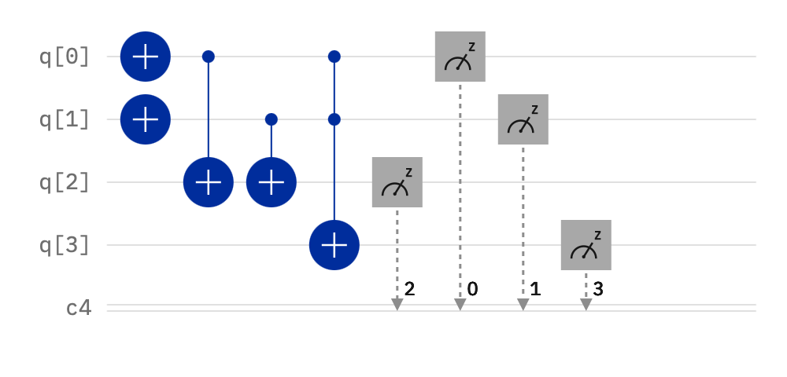
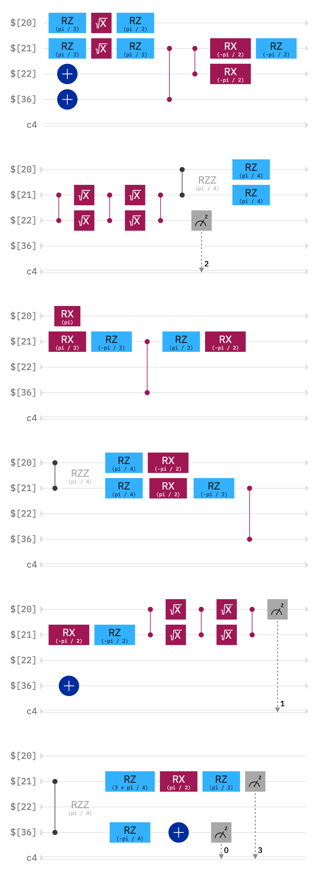
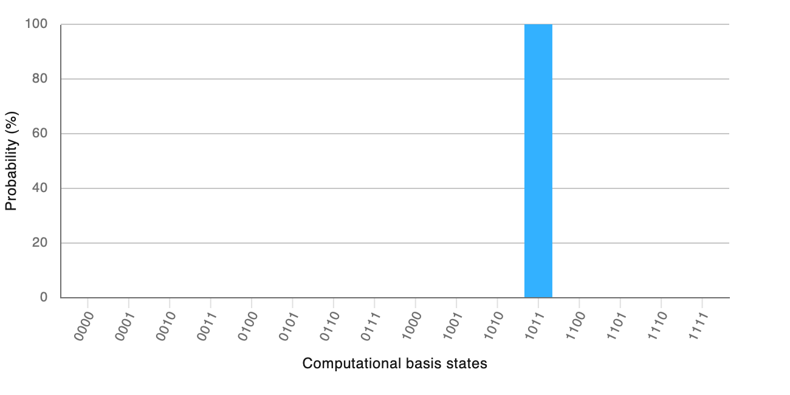
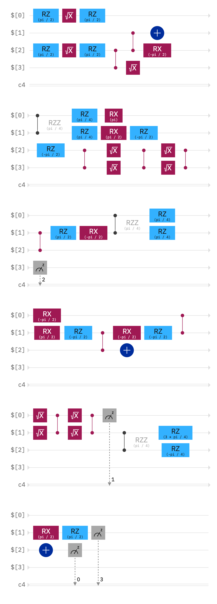
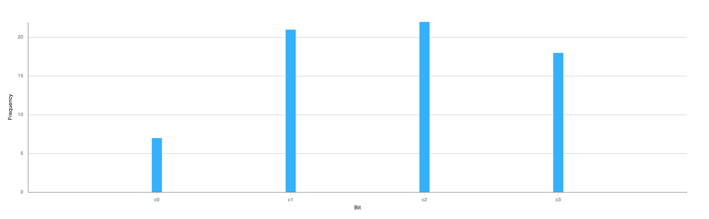
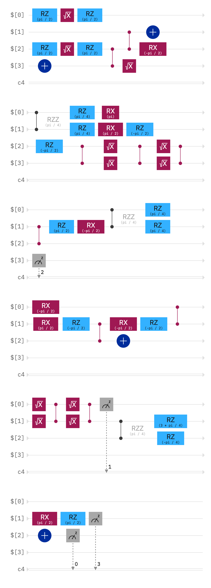
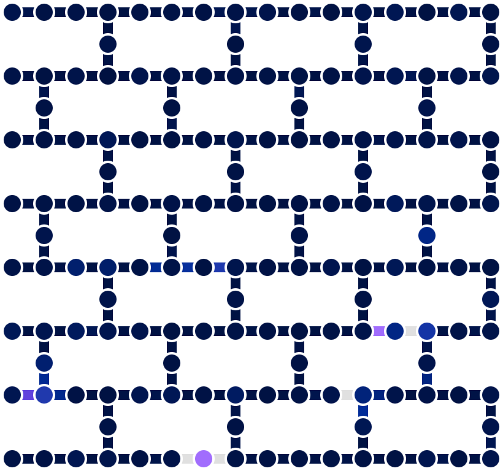

# รายงานปฏิบัติการ Lab 5: Quantum Adders

**รายวิชา:** Quantum Computation, LAB104  
**หัวข้อ:** การสร้างและทดลองวงจร Half Adder บน IBM Quantum Hardware  
**ผู้จัดทำ:** ยามาอัลลุดดีน เจ๊ะหามะ  
**รหัสนักศึกษา:** 6930614038  
**หลักสูตร/รุ่น:** AISE Cohort 3  
**สังกัด:** College of Computing, PSU Phuket  
**วันที่ทดลอง:** 24 พฤศจิกายน 2569

## 1. บทนำ

Quantum Adder เป็นวงจรควอนตัมสำหรับการบวกเลขโดยใช้การดำเนินการแบบย้อนกลับได้ (reversible operations) ซึ่งแตกต่างจากวงจรคลาสสิกทั่วไปที่อาจทำลายข้อมูลอินพุตระหว่างการคำนวณ การทดลองนี้ศึกษาหลักการของ Half Adder และส่งวงจรไปทำงานบน QPU จริงของ IBM Quantum เพื่อเปรียบเทียบผลการวัดกับผลทางทฤษฎี โดยมีผลฮาร์ดแวร์จริงสำหรับอินพุต `11` และ `00`

## 2. วัตถุประสงค์

1. เข้าใจการบวกเลขแบบควอนตัมและความแตกต่างจากการบวกแบบคลาสสิก
2. สร้างวงจร Half Adder ด้วยเกต CNOT และ Toffoli
3. ทดลองวงจรบน IBM Quantum hardware
4. วิเคราะห์ผลกระทบของ noise และ readout error ต่อผลการวัด

## 3. ทฤษฎีที่เกี่ยวข้อง

Half Adder รับอินพุตสองบิต คือ (a) และ (b) แล้วสร้างผลลัพธ์สองส่วน:

\[
Sum = a \oplus b
\]

\[
Carry = a \land b
\]

ในวงจรควอนตัม ใช้ CNOT gate เพื่อคำนวณ XOR และใช้ Toffoli gate เพื่อคำนวณ AND โดยเก็บผลลัพธ์ไว้ใน qubit แยกต่างหาก เพื่อรักษาคุณสมบัติ reversible ของวงจร

## 4. การออกแบบวงจร

กำหนด qubit ดังนี้:

| Qubit | ความหมาย |
|---|---|
| q[0] | อินพุต (a) |
| q[1] | อินพุต (b) |
| q[2] | Sum |
| q[3] | Carry |

สำหรับการทดลองนี้ใช้ (a=1) และ (b=1) โดยเตรียมอินพุตด้วย X gate จากนั้นใช้ CNOT สองตัวคำนวณ Sum และใช้ Toffoli คำนวณ Carry

ไฟล์วงจรต้นฉบับ: [composer-2026-11-24_11-24.qasm](composer-2026-11-24_11-24.qasm)

ไฟล์ Google Colab สำหรับตรวจสอบโค้ด: [Lab5_Quantum_Adders_Colab.ipynb](Lab5_Quantum_Adders_Colab.ipynb)



## 5. ผลทางทฤษฎี

เมื่อ (a=1) และ (b=1):

\[
Sum = 1 \oplus 1 = 0
\]

\[
Carry = 1 \land 1 = 1
\]

การอ่านผลเรียงเป็น (|q_3q_2q_1q_0\rangle = |Carry,Sum,b,a\rangle) ดังนั้นสถานะที่คาดหวังคือ:

```text
1011
```

## 6. การทดลองบน IBM Quantum

### 6.1 รายละเอียดการรัน

| รายการ | ค่า |
|---|---|
| QPU | `ibm_kingston` |
| Processor type | Heron r2 |
| จำนวน qubits ของ QPU | 156 |
| Job ID | `dc2h62anj2vs73dgnoag` |
| สถานะ Job | Completed |
| จำนวน shots | 1,024 |
| อินพุต | (a=1,b=1) |

Job ถูกส่งไปยัง QPU จริง ไม่ใช่ simulator โดยข้อมูลต้นฉบับอยู่ในโฟลเดอร์ [job-dc2h62anj2vs73dgnoag-2](job-dc2h62anj2vs73dgnoag-2/)

### 6.2 วงจรหลังการ Transpile

ระบบได้แปลงวงจรให้เหมาะกับสถาปัตยกรรมของ QPU โดยแมป logical qubits ไปยัง physical qubits ดังนี้:

| Logical qubit | Physical qubit |
|---|---:|
| q[0] | 36 |
| q[1] | 20 |
| q[2] | 22 |
| q[3] | 21 |

วงจรถูกแตกเป็นเกตพื้นฐาน เช่น RZ, RX, SX และเกตสองคิวบิต ก่อนทำการวัดผล



## 7. ผลการทดลอง

ผลการวัดจาก 1,024 shots มีสถานะที่พบดังนี้:

| สถานะ | จำนวนครั้ง | ความน่าจะเป็น |
|---|---:|---:|
| `1011` | 913 | 89.160% |
| `1111` | 23 | 2.246% |
| `0011` | 21 | 2.051% |
| `0101` | 19 | 1.855% |
| `0001` | 16 | 1.562% |
| `1001` | 12 | 1.172% |
| `0010` | 5 | 0.488% |
| `1010` | 5 | 0.488% |
| `0111` | 3 | 0.293% |
| `0000` | 2 | 0.195% |
| `1101` | 2 | 0.195% |
| `0110` | 1 | 0.098% |
| `1000` | 1 | 0.098% |
| `1110` | 1 | 0.098% |



ผลลัพธ์ที่ถูกต้องคือ `1011` ซึ่งพบ 913 ครั้ง คิดเป็น **89.160%** ส่วนผลลัพธ์อื่นรวมกัน 111 ครั้ง คิดเป็น **10.840%**

หมายเหตุ: รูป `probabilities.png` เป็นภาพผลจำลองแบบอุดมคติจาก Composer ส่วนตัวเลขในตารางและค่า 89.160% มาจากผล Job บน QPU จริงในไฟล์ `job-dc2h62anj2vs73dgnoag-result.json`

### 7.1 ผล Half Adder บน QPU จริง: อินพุต `00`

| รายการ | ค่า |
|---|---|
| อินพุต | (a=0,b=0) |
| QPU | `ibm_kingston` |
| Job ID | `dc2k8teq4uuc73a5f1tg` |
| สถานะ | Completed |
| Shots | 1,024 |
| ผลลัพธ์ที่คาดหวัง | `0000` |
| ผลลัพธ์หลัก | `0000` จำนวน 961 ครั้ง |
| Probability ของผลลัพธ์หลัก | 93.848% |

ผลลัพธ์อื่นรวม 63 ครั้ง หรือ 6.152% ซึ่งสะท้อน noise และ readout error ของ QPU จริง ไฟล์ counts อยู่ที่ [half_adder_00_qpu_counts.csv](half_adder_00_qpu_counts.csv) และข้อมูล Job อยู่ใน [job-dc2k8teq4uuc73a5f1tg](job-dc2k8teq4uuc73a5f1tg/)





### 7.2 ผล Half Adder บน QPU จริง: อินพุต `01`

| รายการ | ค่า |
|---|---|
| อินพุต | (a=0,b=1) |
| QPU | `ibm_kingston` |
| Job ID | `dc2kd5uq4uuc73a5f920` |
| สถานะ | Completed |
| Shots | 1,024 |
| ผลลัพธ์ที่คาดหวัง | `0110` |
| ผลลัพธ์หลัก | `0110` จำนวน 948 ครั้ง |
| Probability ของผลลัพธ์หลัก | 92.578% |

ผลลัพธ์อื่นรวม 76 ครั้ง หรือ 7.422% ไฟล์ counts อยู่ที่ [half_adder_01_qpu_counts.csv](half_adder_01_qpu_counts.csv) และข้อมูล Job อยู่ใน [job-dc2kd5uq4uuc73a5f920](job-dc2kd5uq4uuc73a5f920/)


### 7.3 ผล Half Adder บน QPU จริง: อินพุต `10`

| รายการ | ค่า |
|---|---|
| อินพุต | (a=1,b=0) |
| QPU | `ibm_kingston` |
| Job ID | `dc2kf9mq4uuc73a5fcc0` |
| สถานะ | Completed |
| Shots | 1,024 |
| ผลลัพธ์ที่คาดหวัง | `0101` |
| ผลลัพธ์หลัก | `0101` จำนวน 943 ครั้ง |
| Probability ของผลลัพธ์หลัก | 92.090% |

ผลลัพธ์อื่นรวม 81 ครั้ง หรือ 7.910% ไฟล์ counts อยู่ที่ [half_adder_10_qpu_counts.csv](half_adder_10_qpu_counts.csv) และข้อมูล Job อยู่ใน [job-dc2kf9mq4uuc73a5fcc0](job-dc2kf9mq4uuc73a5fcc0/)



เพื่อเปรียบเทียบ ได้จำลอง Half Adder ครบทั้ง 4 อินพุตด้วย Qiskit Aer โดยได้ผลลัพธ์ที่คาดหวัง 100% ในทุกกรณี สามารถดูข้อมูลได้จาก [half_adder_simulation.csv](half_adder_simulation.csv)

## 8. การวิเคราะห์ผล

ผลการทดลองสอดคล้องกับทฤษฎี เนื่องจากสถานะ `1011` มีความถี่สูงที่สุด และแปลความหมายได้ว่า (Sum=0) และ (Carry=1) ซึ่งตรงกับ (1+1=10_2)

อย่างไรก็ตาม การทดลองบน QPU จริงไม่ได้ให้ผลลัพธ์ `1011` ทุกครั้ง โดยมีผลลัพธ์อื่นปนรวม 10.840% ความคลาดเคลื่อนนี้เกิดได้จาก gate noise, readout error, decoherence และข้อจำกัดของการเชื่อมต่อระหว่าง physical qubits

## 9. ข้อมูล Calibration ของ QPU

จากไฟล์ calibration ของ `ibm_kingston` ค่า readout error ของ qubits ที่เกี่ยวข้องอยู่ในช่วงดังนี้:

| Qubit | Readout error |
|---|---:|
| physical qubit 20 | 1.062% |
| physical qubit 21 | 0.476% |
| physical qubit 22 | 1.453% |
| physical qubit 36 | 0.732% |

ค่าเฉลี่ยของ physical qubits ที่ใช้ประมาณ **0.931%** และ qubits ทั้งหมดมีสถานะ Operational เป็น Yes ข้อมูล calibration ใช้ประกอบการอธิบายว่าทำไมผลบนเครื่องจริงจึงมี bitstrings อื่นปนกับผลลัพธ์ที่ถูกต้อง



ไฟล์ calibration: [ibm_kingston_calibrations_2026-11-24T03_46_08Z.csv](ibm_kingston_calibrations_2026-11-24T03_46_08Z.csv)

## 10. สรุปผล

การทดลองสามารถสร้างและรัน Half Adder บน IBM Quantum hardware ได้สำเร็จ วงจรคำนวณ (1+1) ได้ผลทางทฤษฎีเป็น Sum = 0 และ Carry = 1 ซึ่งตรงกับสถานะ `1011` ผลการวัดบน QPU จริงพบสถานะดังกล่าว 89.160% จากทั้งหมด 1,024 shots แสดงว่าวงจรทำงานถูกต้องเป็นส่วนใหญ่ แต่ยังได้รับผลกระทบจาก noise และ readout error ของฮาร์ดแวร์

## 11. ผลการทดลองเพิ่มเติม: Full Adder

Full Adder เพิ่มอินพุต Carry-in โดยกำหนด qubits เป็น (a,b,C_{in},Sum,C_{out}) และใช้สมการ:

\[
Sum = a \oplus b \oplus C_{in}
\]

\[
C_{out} = ab + aC_{in} + bC_{in}
\]

ผลจำลองเชิงอุดมคติสำหรับอินพุตครบทั้ง 8 กรณีเป็นดังนี้:

| a | b | C_in | Sum | C_out | ผลลัพธ์ (C_out Sum) |
|---:|---:|---:|---:|---:|---|
| 0 | 0 | 0 | 0 | 0 | 00 |
| 0 | 0 | 1 | 1 | 0 | 01 |
| 0 | 1 | 0 | 1 | 0 | 01 |
| 0 | 1 | 1 | 0 | 1 | 10 |
| 1 | 0 | 0 | 1 | 0 | 01 |
| 1 | 0 | 1 | 0 | 1 | 10 |
| 1 | 1 | 0 | 0 | 1 | 10 |
| 1 | 1 | 1 | 1 | 1 | 11 |

ผลลัพธ์ในตารางใช้รูปแบบ (C_{out}Sum) โดยผลจำลองควรได้สถานะที่คาดหวัง 100% ในแต่ละอินพุต เนื่องจากไม่มี noise

ผลจำลองที่สร้างด้วย Qiskit Aer ถูกบันทึกไว้ใน [full_adder_simulation.csv](full_adder_simulation.csv) และใช้สคริปต์ [simulate_adders.py](simulate_adders.py)

## 12. ผลการทดลองเพิ่มเติม: 2-bit Ripple-Carry Adder

วงจร 2-bit Ripple-Carry Adder ประกอบด้วย Full Adder สองชุด โดยเริ่มบวกจากบิตต่ำสุด (A_0+B_0) แล้วส่ง Carry ไปยังบิตสูงสุด (A_1+B_1)

ผลการทดลองตามโจทย์:

| A | B | ผลบวกทางคณิตศาสตร์ | Carry | Sum | ผลลัพธ์ไบนารี |
|---|---|---:|---:|---|---|
| 01 | 11 | 4 | 1 | 00 | 100 |
| 10 | 11 | 5 | 1 | 01 | 101 |

ผลลัพธ์ข้างต้นเป็นผลจำลองเชิงอุดมคติของวงจร Ripple-Carry โดยแสดงผลในรูปแบบ (Carry_{out}Sum_1Sum_0) การส่ง Carry จากบิตต่ำไปยังบิตสูงเป็นหลักการสำคัญของวงจรชนิดนี้

ข้อมูลผลจำลองถูกบันทึกไว้ใน [ripple_carry_2bit_simulation.csv](ripple_carry_2bit_simulation.csv)

## 13. ข้อจำกัดและงานต่อยอด

การทดลองบน QPU จริงที่บันทึกในรายงานนี้เป็น Half Adder ครบทั้งสี่อินพุต `00`, `01`, `10`, `11` ส่วน Full Adder และ 2-bit Ripple-Carry Adder ยังมีเฉพาะผลจำลองเชิงอุดมคติตามโจทย์ หากต้องการผลจาก QPU จริงของทุกวงจร ควรส่งวงจรเพิ่มเติมไปยัง IBM Quantum และบันทึก Job results แยกกัน

## 14. คำตอบคำถามแนวคิด

### 14.1 เหตุใด quantum adder ต้องใช้ reversible logic

การคำนวณควอนตัมต้องดำเนินการด้วย unitary operations ซึ่งสามารถย้อนกลับได้ การใช้ reversible logic ช่วยรักษาข้อมูลอินพุตและทำให้วงจรสอดคล้องกับกฎการวิวัฒน์ของระบบควอนตัม เกต CNOT และ Toffoli จึงเหมาะกับการสร้างวงจรบวกเลขมากกว่าเกตตรรกะแบบทำลายข้อมูลทั่วไป

### 14.2 บทบาทของ CNOT และ Toffoli gate

CNOT ใช้คำนวณ XOR และใช้ส่งผลของ qubit หนึ่งไปควบคุมอีก qubit หนึ่ง ส่วน Toffoli มี control สอง qubits และเปลี่ยนค่า target เมื่อ control ทั้งสองเป็น 1 จึงใช้สร้างการคำนวณ AND และ Carry ได้

### 14.3 การส่งต่อ Carry ใน Ripple-Carry Adder

วงจรจะเริ่มบวกจากบิตที่มีค่าน้อยที่สุด Carry-out ของบิตนั้นจะถูกส่งไปเป็น Carry-in ของบิตถัดไป กระบวนการนี้ทำต่อเนื่องจนถึงบิตที่มีค่าสูงที่สุด จึงเรียกว่า Ripple-Carry

### 14.4 เหตุใดขนาดวงจรจึงเพิ่มขึ้นเมื่อจำนวนบิตมากขึ้น

เมื่อเพิ่มจำนวนบิต จะต้องเพิ่ม Full Adder และเส้นทางสำหรับส่งต่อ Carry ทำให้จำนวน qubits, gates และ circuit depth เพิ่มขึ้น นอกจากนี้การรอ Carry จากบิตก่อนหน้าทำให้เกิดความล่าช้าและเพิ่มโอกาสสะสมของ noise

### 14.5 วิธีเพิ่มประสิทธิภาพของ quantum arithmetic

สามารถใช้วงจรที่ลดจำนวนเกตหรือความลึก เช่น Carry-Lookahead Adder, Cuccaro Ripple-Carry Adder หรือวงจรที่ใช้การเพิ่มแบบ modular arithmetic ซึ่งช่วยลดเวลาและผลกระทบจาก noise เมื่อเทียบกับการต่อ Full Adder แบบพื้นฐานจำนวนมาก

## 15. สถานะของงานตามโจทย์ Lab 5

| งาน | สถานะในรายงานนี้ |
|---|---|
| Half Adder | ดำเนินการบน IBM QPU จริงครบทั้ง 4 อินพุต |
| ตรวจสอบตารางค่าความจริงครบ 4 กรณี | ผลจำลองและผล QPU จริงครบทั้ง 4 อินพุต |
| Full Adder | จำลองครบ 8 กรณีด้วย Qiskit Aer |
| 2-bit Ripple-Carry Adder | จำลองตามโจทย์ `01+11` และ `10+11` |
| Simulation และการวิเคราะห์ noise | ดำเนินการแล้ว |
| Concept Questions | ตอบครบแล้ว |

## 16. เอกสารอ้างอิง

1. Komsan K., “Lab 5: Quantum Adders,” quantum-computation repository, GitHub.
2. IBM Quantum Documentation, IBM Quantum Composer and job results.
3. Vedral, V., Barenco, A., & Ekert, A. (1996). Quantum networks for elementary arithmetic operations.
4. Cuccaro, S. A., Draper, T. G., Kutin, S. A., & Moulton, D. P. (2004). A new quantum ripple-carry addition circuit.
