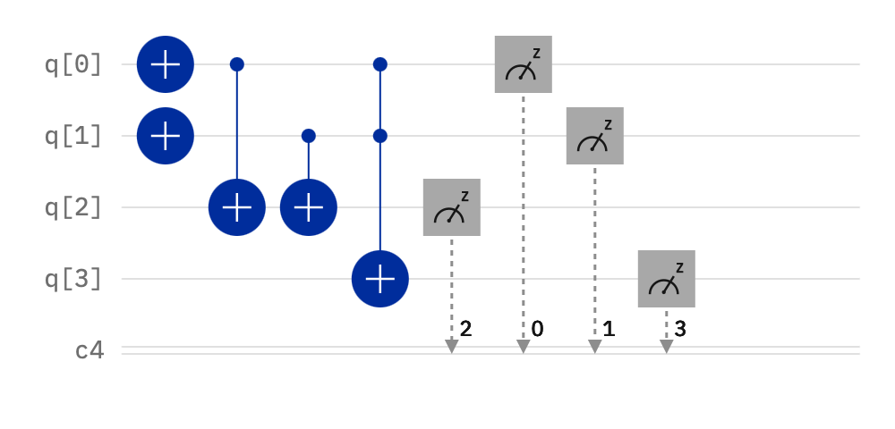
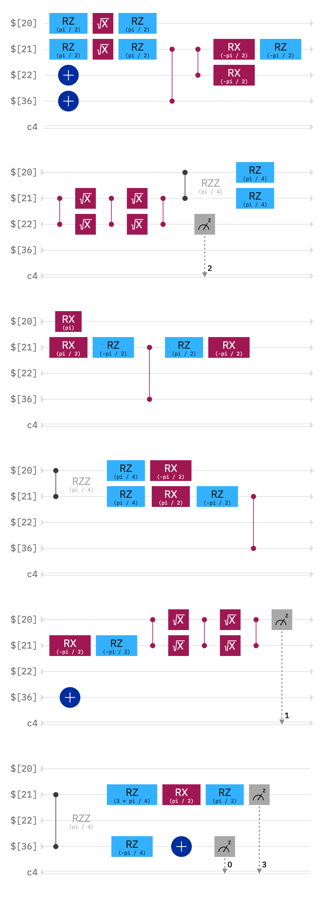
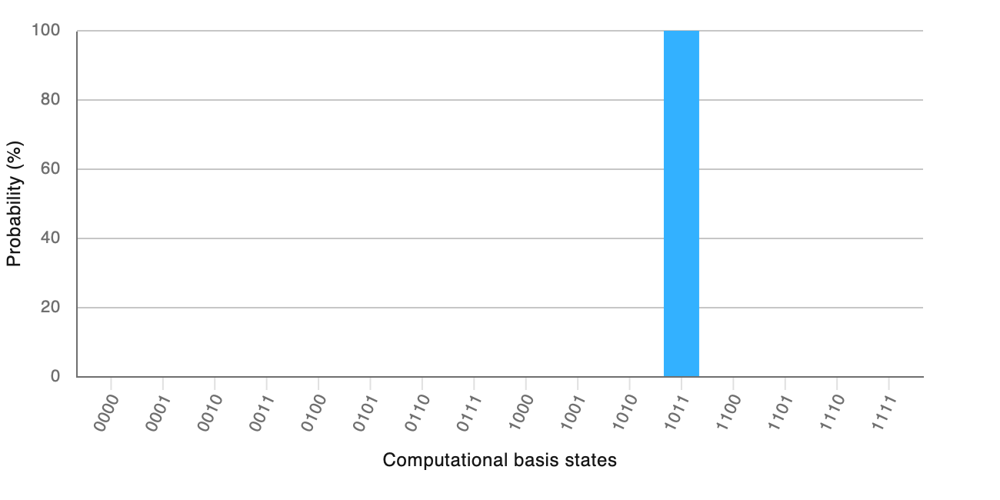
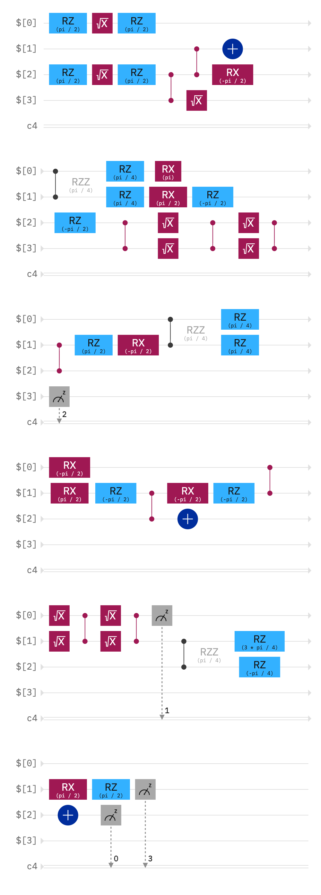
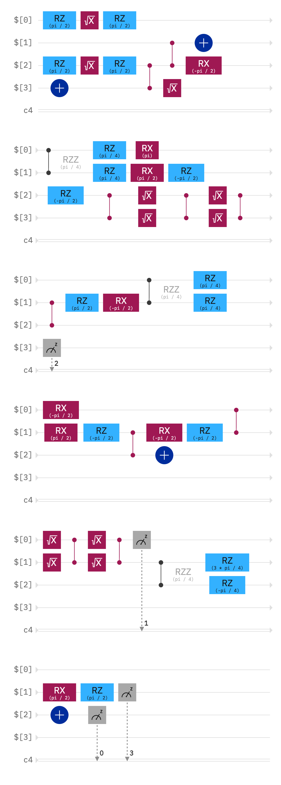
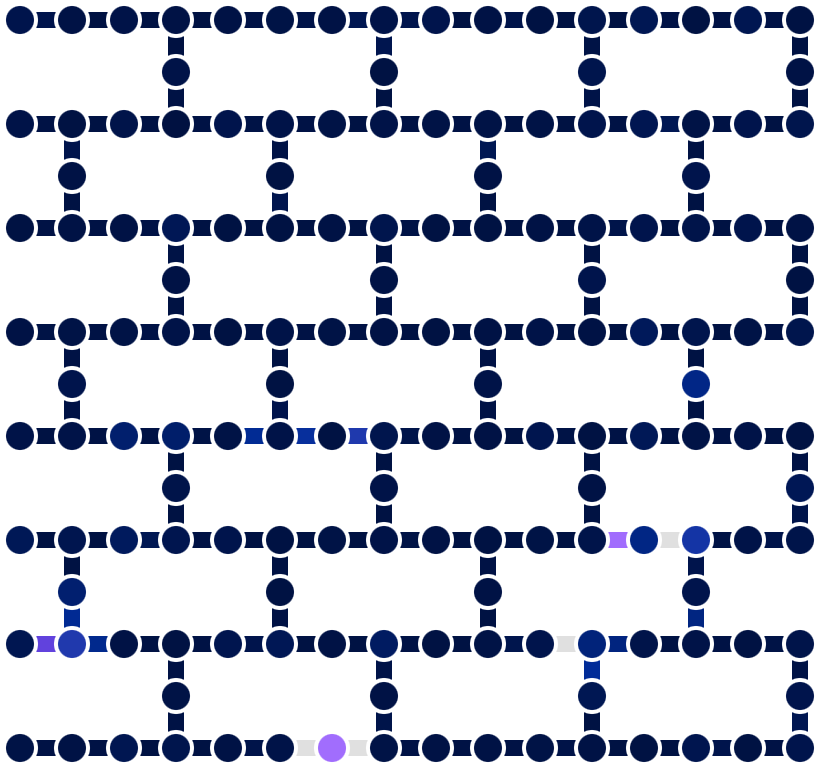

# รายงานปฏิบัติการ Lab 5: Quantum Adders

**รายวิชา:** Quantum Computation, LAB104  
**หัวข้อ:** การสร้างและทดลองวงจร Half Adder บน IBM Quantum Hardware  
**ผู้จัดทำ:** ยามาอัลลุดดีน เจ๊ะหามะ  
**รหัสนักศึกษา:** 6930614038  
**หลักสูตร/รุ่น:** AISE Cohort 3  
**สังกัด:** College of Computing, PSU Phuket  
**วันที่ทดลอง:** 24 พฤศจิกายน 2569

---

## 1. บทนำ

Quantum Adder เป็นวงจรควอนตัมสำหรับการบวกเลขฐานสอง โดยต้องสร้างการคำนวณด้วยการดำเนินการที่ย้อนกลับได้ (reversible operations) เนื่องจากเกตควอนตัมต้องเป็น unitary operation การทดลองนี้ศึกษาวงจร Half Adder ซึ่งรับอินพุต 2 บิตและให้ผลลัพธ์เป็นบิตผลรวม (Sum) กับบิตทด (Carry) โดยใช้ CNOT และ Toffoli gate

นอกจากการจำลองด้วย Qiskit Aer แล้ว ยังนำวงจร Half Adder ไปทดลองบน IBM Quantum hardware เพื่อสังเกตความแตกต่างระหว่างผลลัพธ์เชิงอุดมคติกับผลจากอุปกรณ์จริงซึ่งอาจได้รับผลกระทบจาก noise และ readout error ส่วน Full Adder และ 2-bit Ripple-Carry Adder ในรายงานนี้เป็นผลจำลองตามข้อมูลที่จัดเก็บในโฟลเดอร์ Lab5

## 2. วัตถุประสงค์

1. เข้าใจการบวกเลขแบบควอนตัมและความแตกต่างจากการบวกแบบคลาสสิก
2. สร้างวงจร Half Adder ด้วย CNOT และ Toffoli gate
3. ทดลองวงจร Half Adder บน IBM Quantum hardware
4. เปรียบเทียบผลการวัดกับผลทางทฤษฎีและผลจำลอง
5. วิเคราะห์ผลกระทบของ noise และ readout error
6. ศึกษาการทำงานของ Full Adder และ 2-bit Ripple-Carry Adder ด้วยการจำลอง

## 3. ทฤษฎีที่เกี่ยวข้อง

### 3.1 Half Adder

Half Adder รับอินพุตสองบิต คือ \(a\) และ \(b\) แล้วคำนวณผลลัพธ์ดังนี้:

\[
Sum = a \oplus b
\]

\[
Carry = a \land b
\]

CNOT ใช้สร้าง XOR ระหว่างอินพุต ส่วน Toffoli (CCX) ใช้สร้าง carry เมื่อบิตควบคุมทั้งสองมีค่าเป็น 1 ในวงจรควอนตัมต้องเก็บอินพุตไว้และเขียนผลลัพธ์ลงใน qubit เป้าหมายที่จัดเตรียมไว้

| a | b | Sum | Carry |
|---:|---:|---:|---:|
| 0 | 0 | 0 | 0 |
| 0 | 1 | 1 | 0 |
| 1 | 0 | 1 | 0 |
| 1 | 1 | 0 | 1 |

### 3.2 Full Adder

Full Adder เพิ่มอินพุต Carry-in \(C_{in}\) โดยมีสมการ:

\[
Sum = a \oplus b \oplus C_{in}
\]

\[
C_{out} = ab + aC_{in} + bC_{in}
\]

### 3.3 Ripple-Carry Adder

Ripple-Carry Adder เริ่มบวกจากบิตที่มีนัยสำคัญต่ำสุด แล้วส่ง Carry-out ของแต่ละตำแหน่งไปเป็น Carry-in ของตำแหน่งถัดไป วิธีนี้มีโครงสร้างตรงไปตรงมา แต่ความลึกของวงจรเพิ่มขึ้นตามจำนวนบิต

## 4. การออกแบบและเครื่องมือ

### 4.1 การกำหนด qubit สำหรับ Half Adder

| Qubit | ความหมาย |
|---|---|
| q[0] | อินพุต \(a\) |
| q[1] | อินพุต \(b\) |
| q[2] | Sum |
| q[3] | Carry |

อินพุตถูกเตรียมด้วย X gate เมื่อบิตมีค่าเป็น 1 จากนั้นใช้ CNOT เพื่อคำนวณ Sum และ Toffoli เพื่อคำนวณ Carry โดยวัดผลลัพธ์พร้อมอินพุตที่เก็บไว้

ไฟล์วงจรต้นฉบับ: [composer-2026-11-24_11-24.qasm](composer-2026-11-24_11-24.qasm)  
ไฟล์ Google Colab: [Lab5_Quantum_Adders_Colab.ipynb](Lab5_Quantum_Adders_Colab.ipynb)

### 4.2 เครื่องมือและข้อมูลการทดลอง

- Qiskit และ Qiskit Aer สำหรับสร้างและจำลองวงจร
- IBM Quantum hardware สำหรับการทดลอง Half Adder จริง
- จำนวน shots ต่อ job: 1,024
- QPU ที่บันทึกในผลการทดลอง: `ibm_kingston` (Heron r2, 156 qubits)

## 5. ผลทางทฤษฎีและการอ่านบิต

สำหรับอินพุต \(a=1\) และ \(b=1\):

\[
Sum = 1 \oplus 1 = 0
\]

\[
Carry = 1 \land 1 = 1
\]

เมื่อเรียงสถานะเป็น \(|q_3q_2q_1q_0\rangle = |Carry,Sum,b,a\rangle\) ผลที่คาดหวังคือ `1011` ส่วนอินพุต `00`, `01` และ `10` คาดว่าจะได้ `0000`, `0110` และ `0101` ตามลำดับ

## 6. การทดลอง Half Adder บน IBM Quantum

### 6.1 อินพุต `11`

| รายการ | ค่า |
|---|---|
| QPU | `ibm_kingston` |
| Processor type | Heron r2 |
| จำนวน qubits ของ QPU | 156 |
| Job ID | `dc2h62anj2vs73dgnoag` |
| สถานะ | Completed |
| จำนวน shots | 1,024 |
| อินพุต | (a=1, b=1) |
| สถานะที่คาดหวัง | `1011` |

วงจรถูก transpile ให้เหมาะกับสถาปัตยกรรมของ QPU โดย logical qubits ถูกแมปดังนี้:

| Logical qubit | Physical qubit |
|---|---:|
| q[0] | 36 |
| q[1] | 20 |
| q[2] | 22 |
| q[3] | 21 |

### 6.2 ผลการวัดอินพุต `11`

| สถานะ | จำนวนครั้ง | ความน่าจะเป็น |
|---|---:|---:|
| `1011` | 913 | 89.160% |
| `1111` | 23 | 2.246% |
| `0011` | 21 | 2.051% |
| `0101` | 19 | 1.855% |
| `0001` | 16 | 1.562% |
| `1001` | 12 | 1.172% |
| `0010` | 5 | 0.488% |
| `1010` | 5 | 0.488% |
| `0111` | 3 | 0.293% |
| `0000` | 2 | 0.195% |
| `1101` | 2 | 0.195% |
| `0110` | 1 | 0.098% |
| `1000` | 1 | 0.098% |
| `1110` | 1 | 0.098% |

สถานะที่ถูกต้อง `1011` เกิดขึ้น 913 จาก 1,024 shots หรือ 89.160% ส่วนผลลัพธ์อื่นรวม 111 shots หรือ 10.840% รูป `probabilities.png` เป็นภาพผลจำลองแบบอุดมคติจาก Composer ขณะที่ตารางด้านบนเป็นผลวัดจาก QPU ตามข้อมูล job ที่เก็บไว้

### 6.3 ผล Half Adder สำหรับอินพุตอื่น

| อินพุต (a,b) | Job ID | ผลที่คาดหวัง | ผลลัพธ์หลักบน QPU | จำนวน | ความน่าจะเป็น |
|---|---|---|---|---:|---:|
| `00` | `dc2k8teq4uuc73a5f1tg` | `0000` | `0000` | 961/1,024 | 93.848% |
| `01` | `dc2kd5uq4uuc73a5f920` | `0110` | `0110` | 948/1,024 | 92.578% |
| `10` | `dc2kf9mq4uuc73a5fcc0` | `0101` | `0101` | 943/1,024 | 92.090% |

ผลลัพธ์ที่ไม่ใช่สถานะหลักมีจำนวน 63, 76 และ 81 ครั้ง สำหรับอินพุต `00`, `01` และ `10` ตามลำดับ โดยผล counts และภาพวงจรของแต่ละ job อยู่ในโฟลเดอร์ [job-dc2k8teq4uuc73a5f1tg](job-dc2k8teq4uuc73a5f1tg), [job-dc2kd5uq4uuc73a5f920](job-dc2kd5uq4uuc73a5f920) และ [job-dc2kf9mq4uuc73a5fcc0](job-dc2kf9mq4uuc73a5fcc0)

ภาพวงจรของอินพุต `00`, `01` และ `10`:

- 
- 
- 

ผล Half Adder ครบทั้ง 4 อินพุตยังมีข้อมูลจำลอง Qiskit Aer อยู่ใน [half_adder_simulation.csv](half_adder_simulation.csv) และข้อมูลผล QPU ของแต่ละอินพุตอยู่ในไฟล์ CSV ที่เกี่ยวข้อง เช่น [half_adder_00_qpu_counts.csv](half_adder_00_qpu_counts.csv), [half_adder_01_qpu_counts.csv](half_adder_01_qpu_counts.csv) และ [half_adder_10_qpu_counts.csv](half_adder_10_qpu_counts.csv)

## 7. ผลการทดลองเพิ่มเติม: Full Adder

Full Adder เพิ่ม Carry-in และสร้าง Sum กับ Carry-out ผลจำลองเชิงอุดมคติสำหรับอินพุตทั้ง 8 กรณีเป็นดังนี้:

| a | b | C_in | Sum | C_out | ผลลัพธ์ (C_out Sum) |
|---:|---:|---:|---:|---:|---|
| 0 | 0 | 0 | 0 | 0 | `00` |
| 0 | 0 | 1 | 1 | 0 | `01` |
| 0 | 1 | 0 | 1 | 0 | `01` |
| 0 | 1 | 1 | 0 | 1 | `10` |
| 1 | 0 | 0 | 1 | 0 | `01` |
| 1 | 0 | 1 | 0 | 1 | `10` |
| 1 | 1 | 0 | 0 | 1 | `10` |
| 1 | 1 | 1 | 1 | 1 | `11` |

ข้อมูลจำลองอยู่ใน [full_adder_simulation.csv](full_adder_simulation.csv) และสคริปต์ที่ใช้สร้างผลอยู่ใน [simulate_adders.py](simulate_adders.py) การทดลองส่วนนี้เป็นการจำลองด้วย Qiskit Aer ไม่ใช่การรัน Full Adder บน QPU จริง

## 8. ผลการทดลองเพิ่มเติม: 2-bit Ripple-Carry Adder

วงจรเริ่มบวกจากบิตต่ำสุด แล้วส่ง carry ไปยังตำแหน่งบิตถัดไป ผลจำลองตามโจทย์มีดังนี้:

| A | B | ผลบวกทางคณิตศาสตร์ | Carry | Sum | ผลลัพธ์ไบนารี |
|---|---|---:|---:|---|---|
| `01` | `11` | 4 | 1 | `00` | `100` |
| `10` | `11` | 5 | 1 | `01` | `101` |

ข้อมูลผลจำลองอยู่ใน [ripple_carry_2bit_simulation.csv](ripple_carry_2bit_simulation.csv) การทดลองส่วนนี้เป็นการจำลองเชิงอุดมคติ ไม่ใช่ผลจาก QPU จริง

## 9. การวิเคราะห์ผล

ผลการทดลอง Half Adder บน QPU สอดคล้องกับทฤษฎี เพราะสถานะที่คาดหวังเป็นสถานะที่พบมากที่สุดในทุกกรณีที่ทดสอบ โดยกรณีอินพุต `11` ได้สถานะ `1011` 89.160% และกรณี `00`, `01`, `10` ได้สถานะหลักตรงกับค่าคาดหวัง 93.848%, 92.578% และ 92.090% ตามลำดับ

อย่างไรก็ตาม QPU จริงไม่ได้ให้ผลลัพธ์ที่ถูกต้องทุก shot เนื่องจากวงจรและการอ่านผลได้รับผลกระทบจากความคลาดเคลื่อนของเกต การอ่านค่า และ noise อื่น ๆ ของอุปกรณ์ การ transpile ยังแปลงวงจรเป็นเกตพื้นฐานที่รองรับโดยฮาร์ดแวร์ ดังนั้นผลจริงจึงอาจแตกต่างจากการจำลองแบบอุดมคติ

## 10. ข้อมูล Calibration ของ QPU

ค่า readout error ที่รายงานสำหรับ physical qubits ที่เกี่ยวข้องเป็นดังนี้:

| Physical qubit | Readout error |
|---:|---:|
| 20 | 1.062% |
| 21 | 0.476% |
| 22 | 1.453% |
| 36 | 0.732% |

ค่าเฉลี่ยของ qubits ทั้งสี่อยู่ที่ประมาณ 0.931% และในข้อมูล calibration ที่บันทึกไว้ qubits ทั้งหมดมีสถานะ Operational เป็น Yes

ไฟล์ calibration: [ibm_kingston_calibrations_2026-11-24T03_46_08Z.csv](ibm_kingston_calibrations_2026-11-24T03_46_08Z.csv)

## 11. ข้อจำกัดและงานต่อยอด

ผล QPU จริงในรายงานนี้ครอบคลุม Half Adder ทั้งสี่ชุดอินพุต ส่วน Full Adder และ 2-bit Ripple-Carry Adder เป็นผลจำลองด้วย Qiskit Aer เท่านั้น จึงไม่ควรตีความผลของสองวงจรหลังว่าเป็นผลจากฮาร์ดแวร์จริง งานต่อยอดสามารถนำวงจร Full Adder และ Ripple-Carry ไป transpile และรันบน QPU โดยบันทึก backend, job ID, จำนวน shots และผล counts เพื่อเปรียบเทียบกับ simulator

## 12. คำตอบคำถามแนวคิด

### 12.1 เหตุใด quantum adder ต้องใช้ reversible logic?

การดำเนินการในวงจรควอนตัมต้องเป็น unitary operation ซึ่งย้อนกลับได้ การคำนวณจึงต้องเก็บข้อมูลอินพุตหรือใช้ qubits เพิ่มเติมสำหรับผลลัพธ์และข้อมูลช่วย แทนการทิ้งข้อมูลระหว่างคำนวณ

### 12.2 บทบาทของ CNOT และ Toffoli gate คืออะไร?

CNOT ใช้ควบคุมการพลิกค่าเป้าหมายและนำไปสร้าง XOR สำหรับ Sum ส่วน Toffoli มี control สอง qubits และพลิก target เมื่อ control ทั้งสองเป็น 1 จึงใช้สร้างเงื่อนไข carry แบบ AND ได้

### 12.3 Carry ส่งต่อใน Ripple-Carry Adder อย่างไร?

วงจรเริ่มจากบิตที่มีนัยสำคัญต่ำสุด Carry-out ของตำแหน่งหนึ่งถูกนำไปใช้เป็น Carry-in ของตำแหน่งถัดไป จึงเกิดการส่งต่อ carry ตามลำดับจนถึงบิตสูงสุด

### 12.4 เหตุใดขนาดวงจรจึงเพิ่มขึ้นเมื่อจำนวนบิตมากขึ้น?

เมื่อเพิ่มจำนวนบิต ต้องเพิ่มวงจรคำนวณผลรวมและ carry สำหรับแต่ละตำแหน่ง รวมทั้งเส้นทางส่งต่อ carry ทำให้จำนวนเกตและความลึกของวงจรเพิ่มขึ้นตามขนาดอินพุต

### 12.5 วิธีเพิ่มประสิทธิภาพ quantum arithmetic มีอะไรบ้าง?

การออกแบบที่ลดจำนวนเกตหรือความลึกของวงจร เช่น carry-lookahead และวงจร quantum ripple-carry ที่ปรับให้เหมาะสม อาจช่วยลดเวลาและผลกระทบจาก noise อย่างไรก็ตาม การเลือกใช้ขึ้นกับ trade-off ระหว่างจำนวน qubits, จำนวนเกต และความลึกของวงจร

## 13. สถานะของงานตามโจทย์ Lab 5

| งาน | สถานะ |
|---|---|
| Half Adder | ทดลองบน IBM Quantum hardware ครบทั้ง 4 อินพุต |
| ตรวจสอบตารางความจริง Half Adder | มีผลจำลองและผล QPU สำหรับทั้ง 4 อินพุต |
| Full Adder | จำลองครบ 8 กรณีด้วย Qiskit Aer |
| 2-bit Ripple-Carry Adder | จำลองกรณี `01+11` และ `10+11` |
| วิเคราะห์ noise และ readout error | วิเคราะห์จากผล QPU และข้อมูล calibration ที่บันทึกไว้ |
| คำถามแนวคิด | ตอบครบ 5 ข้อ |

## 14. เอกสารอ้างอิง

1. Komsan K., “Lab 5: Quantum Adders,” [quantum-computation repository](https://github.com/komsan-k/quantum-computation/tree/9d6aece722653c87cd30371f9e7967afc517c1e6/lab/lab-5-quantum-adder).
2. IBM Quantum Documentation, IBM Quantum Composer and job results.
3. Vedral, V., Barenco, A., & Ekert, A. (1996). “Quantum networks for elementary arithmetic operations.” *Physical Review A*, 54(1), 147.
4. Cuccaro, S. A., Draper, T. G., Kutin, S. A., & Moulton, D. P. (2004). “A new quantum ripple-carry addition circuit.” arXiv:quant-ph/0410184.
5. Nielsen, M. A. & Chuang, I. L. *Quantum Computation and Quantum Information*. Cambridge University Press.
